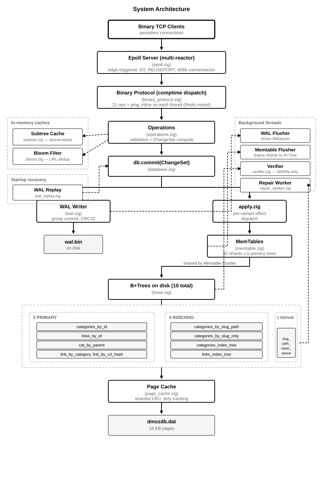

# zig-directory

zig-directory is a web directory in the style of DMOZ. Categories nest, links sit inside them, and you can browse,
search and submit. It is three programs. `dmozdb` is the database, written in Zig. The website is a Deno and Fresh app
that talks to `dmozdb`. The MCP server lets AI clients use the directory through the website's API. Only the website
and the MCP server are meant to face the internet.

The live site is [directory.junaid.guru](https://directory.junaid.guru). The sample store in this repository,
`data/store.dat.zip`, holds 92,001 links in 59,218 categories, so you can try the code on a realistic amount of data.

## What is interesting about it

- **A database written for one job.** `dmozdb` has no query language. It has 38 binary operations plus ping, each
  written for something the directory does: browse a category, list every link under it, search, count.
- **An acknowledged write is on disk.** A write gets its answer only after the log has been `fdatasync`ed. Writes from
  many connections share one sync (group commit).
- **Checkpoints survive a crash.** Pages go to a journal first and then into the data file. A crash between the two
  steps is repaired on the next start.
- **Memory is reserved at start-up.** Each reactor thread has a scratch slab for requests. A request that needs more
  than its slab fails with a protocol error and the server does not grow.
- **Hybrid search.** Keyword postings and int8 vectors are combined with reciprocal rank fusion. The website computes
  the embeddings, and `dmozdb` never runs a model.
- **Graph questions.** An in-memory facts index answers questions such as "how many sites are hosted on tripod.com".
- **TigerStyle, checked by a program.** `src/tidy.zig` enforces line and function length, naming, bounded loops and
  banned patterns, and it runs inside `zig build test`.

The storage engine (paged file, B+Trees, page cache, write-ahead log, epoll server) is a separate library,
[zigstore](https://github.com/poly-glot/zigstore). This repository holds the directory schema, the operations, the
background workers and the protocol handlers.

## Status

- One author. This is a personal project, not a team product, and nobody is on call for it.
- Linux only. The server uses epoll and `O_DIRECT`. It compiles on macOS but crashes at the first Linux-only system
  call, so it does not run on macOS or Windows. Use the [Dev Container](#macos-and-windows) there.
- Built with AI assistance. A lot of the code was written with Claude Code, under the rules in
  [`.claude/`](.claude/): a project contract in [`CLAUDE.md`](CLAUDE.md), rule files in
  [`.claude/rules/`](.claude/rules/) and hooks that run the test gate before a session may finish. Every change still
  has to pass the same gates a person's would (see [CONTRIBUTING.md](CONTRIBUTING.md)).
- Version 0.6.0, not tagged. There is no stability promise for the wire protocol or the on-disk format. The store
  carries a format version and upgrades older ones when it starts.
- There is no authentication in `dmozdb` itself. Read [SECURITY.md](SECURITY.md) before you expose anything.

## Quickstart

You need a Linux machine with [Zig 0.16.0](https://ziglang.org/download/), `unzip` and `bash`. This builds the
server, unpacks the sample store, starts the server and sends it a ping and a stats request.

```bash
git clone https://github.com/poly-glot/zig-directory.git
cd zig-directory
zig build -Doptimize=ReleaseSafe

export DMOZDB_DATA_DIR=/tmp/dmozdb-data
mkdir -p "$DMOZDB_DATA_DIR"
unzip -q data/store.dat.zip -d "$DMOZDB_DATA_DIR"
export DMOZDB_VECTOR_MODEL="$PWD/models/vector_model.bin"
./zig-out/bin/dmozdb &
sleep 2
```

Three things trip people up. The data directory must be an absolute path. The server refuses to start without
`DMOZDB_VECTOR_MODEL`. The sample store is 506 MB once unzipped.

The server listens on `127.0.0.1:8080`. Send it a ping (op 255) and a stats request (op 15) with bash alone:

```bash
exec 3<>/dev/tcp/127.0.0.1/8080
printf '\x08\x00\x00\x00\xff\x00\x00\x00' >&3
head -c 10 <&3 | od -An -tx1
printf '\x08\x00\x00\x00\x0f\x00\x00\x00' >&3
head -c 58 <&3 | tail -c 48 | od -An -tu8
exec 3>&-
```

The first command prints the 10-byte response header of the ping. The second prints six unsigned 64-bit numbers:
categories, links, pages, cache hits, cache misses and pending WAL entries. The frame layout is in the
[protocol reference](docs/protocol.md#wire-format).

Stop the server with `SIGTERM`. It drains its queues and runs a final checkpoint before it exits.

```bash
kill -TERM $(pidof dmozdb)
```

### macOS and Windows

`dmozdb` does not run natively there. The repository has a [Dev Container](.devcontainer/devcontainer.json) for VS
Code and GitHub Codespaces: Ubuntu 24.04 with Zig 0.16.0 and ZLS installed. Open the folder in it, then follow the
quickstart above inside the container. Docker Desktop is enough on macOS and Windows.

The Dev Container bind-mounts `~/.claude` from your home directory and will not start if that directory does not exist,
so run `mkdir -p ~/.claude` first. You can also build the backend image yourself, see
[Run with Docker](#run-with-docker).

### The website

The website is optional and needs [Deno](https://deno.com). It reads `DMOZDB_HOST` and `DMOZDB_PORT` to find the
server, and it needs `DMOZDB_HOST=127.0.0.1`: without it, IPv6 resolution gives "Directory service unavailable". See
[`web/README.md`](web/README.md) for the rest of its setup.

## Where to read more

| Document | What is in it |
|----------|---------------|
| [docs/protocol.md](docs/protocol.md) | The binary protocol: wire format, every op, status and sub-status codes |
| [docs/architecture.md](docs/architecture.md) | B+Tree, page cache, WAL, slug paths and repair, event loop, insert path, search, and the reasons behind the design |
| [docs/operations.md](docs/operations.md) | Data files, monitoring, shutdown, backup and the Kubernetes deployment |
| [CONTRIBUTING.md](CONTRIBUTING.md) | How to build, test and change the code |
| [SECURITY.md](SECURITY.md) | The threat model and how to report a problem privately |
| [CHANGELOG.md](CHANGELOG.md) | What changed, by version |
| [NOTICE.md](NOTICE.md) | Third-party data and models, and their licences |
| [bench/README.md](bench/README.md) | The benchmark tool |

---

## Features

- **zigstore engine**: 16 KB paged file, B+Trees, sharded LRU page cache with free-list management
- **Write-Ahead Log (WAL)** with group commit; a write is acknowledged only after `fdatasync`
- **Binary TCP protocol** with 38 ops + ping, processed inline on the epoll thread
- **Multi-reactor epoll** with edge-triggered non-blocking I/O and `SO_REUSEPORT`
- **Redis-style two-pass event loop**: read all, then write all
- **4,096 concurrent connections** per reactor with a per-connection state machine
- **Hierarchical categories** with slug-based path routing via on-disk B+Tree indices
- **Full-text search** across categories and links via posting-list B+Trees
- **Duplicate URL detection** via bloom filter + hash index
- **Moderation workflow**: pending / approved / rejected link status, per-submitter index, bulk status ops
- **Background verifier** and **slug-path repair worker** for large rename/move operations
- **Comptime-generic handlers**: payload parsing, batch create, get/delete and bitmask updates are each one helper reused across ops

---

## Architecture

### System Overview

<p align="center">
  
</p>

> Diagram source: [`diagrams/01-system-architecture.mmd`](diagrams/01-system-architecture.mmd)

### Engine

`dmozdb` is built on **zigstore** (`github.com/poly-glot/zigstore`, pinned in `build.zig.zon`, currently `v4.0.0`). The
library owns the generic machinery:

| zigstore module                      | Responsibility                                                            |
|--------------------------------------|---------------------------------------------------------------------------|
| `engine.zig`                         | `Engine(schema)`: page-0 header, named B+Trees, memtables, counters, recovery |
| `page.zig`, `btree/`, `freelist.zig` | 16 KB page format, B+Tree insert/search/delete/range scan, free-page chain |
| `page_cache.zig`                     | 64-shard LRU buffer pool with pin counting and dirty tracking             |
| `memtable.zig`                       | 32-shard in-memory write buffer per memtable-backed index                 |
| `wal.zig`, `wal_replay.zig`          | Group-commit WAL writer, `awaitDurable`, replay                           |
| `commit.zig`                         | `commit()`: WAL append → ordered apply → wait for fsync                   |
| `snapshot.zig`                       | `forceSnapshot` and the `snapshot.meta` superblock                        |
| `epoll.zig`, `connection.zig`, `run.zig` | Multi-reactor epoll server, connection slots, bootstrap               |
| `protocol/framing.zig`               | Request/response framing, `processFrames`, per-op latency histograms      |
| `server_config.zig`                  | `ServerConfig.fromEnv(prefix)`: port, bind, trusted IPs/CIDRs, sizing     |
| `bloom.zig`, `inverted_index.zig`, `codec.zig` | Bloom filter, tokenizer, `FixedString`, composite keys           |
| `tsgen.zig`                          | TypeScript client generator behind `zig build gen-client-ts`              |

This repository (`src/`) declares the directory schema (`zigstore.schema(...)` in `src/directory.zig`), the `Category` /
`Link` / `RepairTask` records, the operations, the `ChangeSet` type and its apply functions, the verifier, the repair
worker and the binary-protocol op handlers.

### Storage Layout

The store lives in `DMOZDB_DATA_DIR` as `store.dat` (16 KB pages), `wal.bin` and `snapshot.meta`:

- **Page 0**: file header (magic `DMOZ` / `0x444D4F5A`, `format_version` 10, a root page + entry count per index, the
  three ID counters `next_category_id`, `next_link_id`, `next_repair_seq`, and the `embedding_model` id). A format 5 to
  9 header is rewritten to format 10 at boot, one format at a time; data pages are untouched, and the step to format 10
  recounts every category once before the server listens
- **Pages 1+**: B+Tree nodes. Every root is allocated lazily on first insert and recorded in the header, so no page
  number is fixed beyond page 0

Fourteen B+Trees back the read and write paths; the first six are also fronted by a memtable:

| Index                       | Key                       | Value                     | Memtable | Purpose                                            |
|-----------------------------|---------------------------|---------------------------|----------|----------------------------------------------------|
| `categories_by_id`          | category ID               | Category (1,288 bytes)    | yes      | Primary category lookup                            |
| `cat_by_parent`             | parent_id ++ child_id     | child ID                  | yes      | Hierarchy traversal                                |
| `links_by_id`               | link ID                   | Link (1,888 bytes)        | yes      | Primary link lookup                                |
| `link_by_category`          | category_id ++ link_id    | link ID                   | yes      | Links within a category                            |
| `link_by_url_hash`          | hash(url)                 | link ID                   | yes      | Duplicate URL detection                            |
| `link_by_submitter`         | submitter_id ++ link_id   | link ID                   | yes      | Links submitted by a user (op 27)                  |
| `categories_by_slug_path`   | full slug path            | category ID               | no       | Slug-path → ID resolution                          |
| `categories_by_slug_only`   | leaf slug                 | category ID               | no       | Leaf-slug → ID (shallowest holder)                 |
| `categories_index_tree`     | token ‖ category ID (BE)  | (empty)                   | no       | Posting list for category text search              |
| `links_index_tree`          | token ‖ link ID (BE)      | (empty)                   | no       | Posting list for link text search                  |
| `slug_path_repair_queue`    | repair_seq (BE)           | RepairTask (2,080 bytes)  | no       | Pending descendant slug-path cleanups              |
| `link_vectors`              | link ID                   | LinkVector (512 bytes)    | no       | int8 embedding per link for hybrid search          |
| `link_entities`             | link ID                   | Entity facts (<= 1,062 B) | no       | Places, religions, people and orgs a link names    |
| `category_vectors`          | category ID               | StoredVector (400 bytes)  | no       | int8 embedding per category for `neighbours`       |

### Network Layer

- **Binary TCP protocol** on a single port (default 8080)
- **Multi-reactor epoll** with `SO_REUSEPORT`; `max(DMOZDB_THREAD_COUNT / 2, 1)` reactors
- **Edge-triggered events** (`EPOLLET`)
- **Redis-style two-pass event loop**: all reads processed before any writes
- **Inline frame processing**: ops run directly on the epoll thread
- **64 KiB request buffer**, **256 KiB response buffer** per connection
- **TCP_NODELAY** on every accepted socket

### Durability

Writes follow the WAL-first protocol via the ChangeSet pipeline:

1. **Compute**: `src/operations/operations_changeset_compute.zig` builds a typed `ChangeSet` describing every on-disk effect
   of the mutation (primary record, secondary indexes, ancestor count cascades, token entries).
2. **Commit**: `db.commit(cs)` calls `zigstore.commitSeq`, which encodes the ChangeSet, appends it to the WAL as op
   `100` (CRC32 + monotonic sequence) and applies it under the engine's apply mutex in sequence order. Inside a request,
   `commit` records the sequence and returns, so the operation releases `write_mutex` at once; `Directory.dispatch`
   then waits in `awaitDurable` for the highest sequence the request wrote before the response leaves. **The ack is the
   fsync**: no `ok` for a write is sent until that entry, and every entry before it, is on disk. A commit made outside
   a request (tests, the repair worker) waits for its own entry before returning.
3. **Apply**: `src/apply/*.zig` walks the ChangeSet variants. Effects on the six memtable-backed indexes go to that index's
   32-shard memtable; token entries and repair-queue writes go straight to their B+Trees; ancestor counts are rewritten
   synchronously in the same apply.
4. **Background drain**: the memtable flusher worker drains memtables into the B+Trees every 5 ms. Dirty pages stay in
   the page cache until a checkpoint: the cache never evicts a dirty page, so `store.dat` changes only at checkpoints.
5. **Group commit**: the WAL flusher wakes every 2 ms or when `DMOZDB_WAL_BATCH_SIZE` entries (default 256) are
   pending, writes the batch and `fdatasync`s once.

6. **Checkpoint**: every `DMOZDB_SNAPSHOT_INTERVAL_S` seconds (and on shutdown, after recovery, and on op 22 `snapshot`)
   the engine pauses WAL appends until every appended entry has applied, drains the memtables, writes every dirty page
   plus the superblock to `checkpoint.journal` (fsync), then in place into `store.dat` (fsync), truncates the journal and
   `wal.bin`, and records the checkpointed WAL sequence in the superblock's `seq`. A crash between the two phases is
   repaired on the next open by redoing the journal; a crash before the journal is complete leaves `store.dat` exactly
   as the previous checkpoint left it. When more than half the page cache is dirty, the checkpointer, the drain and the
   commit path flush pages early (same journal, no WAL truncation) so a write burst cannot exhaust the cache.

On boot, recovery redoes a complete `checkpoint.journal` if one is present, replays every `wal.bin` entry above the
superblock's `seq` through the same `apply()` path and checkpoints. Category counts live in the records and the three
link-status counts live in superblock counters, both checkpointed with the tree, so replay leaves them exact and boot
reads nothing else before the port opens. A store that has never checkpointed them (`derived_counts_version` = 0, as on
the first boot after upgrading) is recounted once. The URL bloom filter is seeded after the port opens by a background
thread in 512-link chunks, pausing after each chunk for as long as it took so request reads get at least half the disk;
until it finishes, duplicate checks skip the filter and read the url-hash index, so a duplicate is never missed. `snapshot.meta` is written by op 22 and `dmoz_import` for
operators; the WAL sequence resumes from the superblock. A WAL that fails to open, a WAL whose `fdatasync` has failed
(further commits are refused and the process restarts), and a WAL with valid records more than one batch beyond a corrupt
record all refuse to start rather than serve or silently drop data.

The [architecture notes](docs/architecture.md) go deeper: the B+Tree and page cache, the write-ahead log, slug-path
resolution and repair, the connection state machine and event loop, the link insert path and search, and the reasons
behind each design decision.

---

## Other ways to build and run

### Build options

```bash
zig build                         # debug; produces zig-out/bin/dmozdb only
zig build -Dtools=true            # also zig-out/bin/bench and zig-out/bin/dmoz_import
zig build -Doptimize=ReleaseSafe  # optimised, every assertion kept
zig build test                    # the test suite and the tidy checker
```

`bench` is always compiled `ReleaseFast` regardless of `-Doptimize`, so its numbers stay comparable. `dmoz_import` writes the store the server opens, so it follows `-Doptimize` and builds `ReleaseSafe` when none is given. CI runs both `zig build test`
and `zig build -Dtools=true`.

### Run with Docker

The backend (Zig) and the web frontend (Deno/Fresh) build as two separate images.

```bash
# Build the backend image
docker build -f Dockerfile.backend -t dmozdb-backend:latest .

# Run the backend (binary protocol on 8080)
docker run -d \
  --name dmozdb \
  -p 8080:8080 \
  -e DMOZDB_TRUSTED=172.16.0.0/12 \
  -v dmozdb-data:/var/lib/dmozdb \
  dmozdb-backend:latest

# Build the web frontend image
docker build -f Dockerfile.web -t dmozdb-web:latest .

# Run the web frontend (point it at the backend + a denokv instance)
docker run -d \
  --name dmozdb-web \
  -p 8000:8000 \
  -e DMOZDB_HOST=host.docker.internal -e DMOZDB_PORT=8080 \
  -e KV_PATH=http://host.docker.internal:4512 -e DENO_KV_ACCESS_TOKEN=dev-token \
  dmozdb-web:latest
```

The image binds `0.0.0.0` and trusts only loopback unless `DMOZDB_TRUSTED` says otherwise (see
[Protected mode](docs/architecture.md#protected-mode)). Connections published through `-p` arrive from the Docker
network, not from loopback, so without `DMOZDB_TRUSTED` the server drops every one of them and logs `Protected mode:
rejected connection from ...`. `172.16.0.0/12` covers the default bridge network. If the log still shows rejections,
trust the address it names. The web container reaches the backend through `host.docker.internal`, which is not
loopback either, so the `DMOZDB_TRUSTED` value on the backend has to cover that path as well.

The data volume starts empty, so the container starts with an empty store. To serve the sample store, unzip
`data/store.dat.zip` into the volume first.

### Dev Container

The project includes a full [Dev Container](.devcontainer/devcontainer.json) configuration for VS Code and GitHub Codespaces:

- Ubuntu 24.04 with Zig 0.16.0 and ZLS 0.16.0 pre-installed
- Docker-in-Docker enabled for container builds
- VS Code extensions: Zig language support, GitLens, ShellCheck
- Port 8080 auto-forwarded

| Alias   | Command                                                  | Description             |
|---------|----------------------------------------------------------|-------------------------|
| `zb`    | `zig build`                                              | Build the project       |
| `zt`    | `zig build test`                                         | Run all tests           |
| `zr`    | `zig build run`                                          | Run the server          |
| `zfmt`  | `zig fmt src/`                                           | Format all source files |
| `db`    | `docker build -f Dockerfile.backend -t dmozdb-backend .` | Build backend image     |
| `dbw`   | `docker build -f Dockerfile.web -t dmozdb-web .`         | Build web image         |
| `dr`    | `docker run --rm -p 8080:8080 dmozdb-backend`            | Run backend container   |

The `dr` alias does not set `DMOZDB_TRUSTED`, so the server rejects every client outside the container, as described
under [Run with Docker](#run-with-docker). Use the full `docker run` line from there when you need to reach it.

---

## Configuration

All configuration is via environment variables. Every setting has a default. The `DMOZDB_PORT` … `DMOZDB_TRUSTED` rows
are read by `zigstore.ServerConfig.fromEnv("DMOZDB_")`; the rest by `src/main.zig` and `src/directory.zig`.

| Variable                                  | Type   | Default           | Description                                                                 |
|-------------------------------------------|--------|-------------------|-----------------------------------------------------------------------------|
| `DMOZDB_PORT`                             | u16    | `8080`            | Binary protocol listen port                                                 |
| `DMOZDB_BIND`                             | IPv4   | `127.0.0.1`       | Address to bind the listen socket                                           |
| `DMOZDB_TRUSTED`                          | string | (none)            | Comma-separated IPv4 addresses and/or CIDRs (`10.0.0.5,10.244.0.0/16`) allowed to connect |
| `DMOZDB_CACHE_SIZE_MB`                    | u32    | `256`             | Page cache size in megabytes (1–67108863, the engine's u32 frame count)     |
| `DMOZDB_THREAD_COUNT`                     | u32    | auto              | 0 = CPU count (capped at 32); the server runs `max(n / 2, 1)` reactors      |
| `DMOZDB_SNAPSHOT_INTERVAL_S`              | u32    | `300`             | Seconds between periodic checkpoints (drain, journal, `wal.bin` truncate)   |
| `DMOZDB_WAL_SYNC_INTERVAL_MS`             | u32    | `50`              | Parsed, currently unused: the WAL flusher timer is a fixed 2 ms             |
| `DMOZDB_WAL_BATCH_SIZE`                   | u32    | `256`             | WAL entries that trigger an immediate group flush                           |
| `DMOZDB_DATA_DIR`                         | string | `/var/lib/dmozdb` | Directory for `store.dat`, `wal.bin`, `snapshot.meta`                       |
| `DMOZDB_RENAME_INLINE_THRESHOLD`          | u32    | `5000`            | Subtree size at which rename/move flips from in-line strict to queued async repair (at most 7224, so the swaps fit one WAL record) |
| `DMOZDB_REPAIR_WORKER_INTERVAL_MS`        | u32    | `1000`            | Repair-worker tick interval (ms)                                            |
| `DMOZDB_REPAIR_WORKER_CHUNK_SIZE`         | u32    | `1000`            | Descendants visited per worker chunk, each under the write lock (~45 ms); at most 7224 |
| `DMOZDB_VERIFIER_INTERVAL_S`              | u32    | `300`             | Seconds between background verifier runs                                    |
| `DMOZDB_SCRATCH_SLAB_MB`                  | u32    | `32`              | Request scratch slab per reactor thread, MiB (1–1024); a request that outgrows it fails |
| `DMOZDB_VECTOR_MODEL`                     | string | `/usr/local/share/dmozdb/vector_model.bin` | Vector model loaded at boot; the server refuses to start without it |

---

## Binary protocol

`dmozdb` speaks one binary protocol over TCP: an 8-byte request header, a 10-byte response header, and 38 ops plus
ping. The web tier calls it through a generated TypeScript client. The [protocol reference](docs/protocol.md) has the
wire format, every op with its payload layout, and the status and sub-status codes.

## Operating it

The server keeps `store.dat`, `wal.bin`, `checkpoint.journal`, `snapshot.meta` and `derived.snap` in its data
directory, shuts down with a final checkpoint, and has no online backup. The [operations guide](docs/operations.md)
covers those files, the metrics to watch, graceful shutdown, backup, and the Kubernetes deployment that runs the live
site.

---

## Testing

### Unit and Integration Tests

```bash
zig build test
```

This compiles the test graph rooted at `src/main.zig`, which pulls in every module under `src/`:

- **Schema**: `Category` / `Link` / `RepairTask` sizes and round-trips, composite keys
- **ChangeSet**: encode/decode of every effect variant
- **Apply**: effect handlers, ancestor count cascades, token writes, repair-queue writes
- **Operations**: categories (CRUD, hierarchy, circular-move rejection), links (CRUD, duplicate URL, status counts),
  slug-path resolution and validation gate, search (all-terms, ranked, hybrid), link vectors, subtree listing
- **Binary protocol**: payload parsing, sub-status mapping, response headers, `list_subtree_links`, `snapshot`,
  `op_latency_stats`, `stats`
- **Directory**: header round-trips, counters across reopen, recovery boot path
- **Verifier and repair worker**: drift detection, queue drain
- **E2E** (`src/e2e_test.zig`): full workflows against a temp data dir, crash-and-replay (an acked commit survives an
  unclean crash), duplicate refusal before and after the bloom is seeded, status counts restored from the checkpoint
  and recounted once on a legacy store, snapshot persistence

The engine's own tests (page format, B+Tree, page cache, free list, WAL, connection, framing) live and run in the
zigstore repository.


---

## Performance

The repository backs a few measured numbers, and this section holds only those. They come from the benchmark client
in [`bench/`](bench/README.md). It covers eight workloads and reports p50, p95, p99 and p99.9 latency, throughput and
server memory (RSS) as JSON Lines, which makes runs comparable. The full matrix, with the capture environment, is in
[`bench/baseline-2026-10-17-summary.md`](bench/baseline-2026-10-17-summary.md) and the raw records sit next to it.

| Workload (4 clients) | Recorded baseline | Reproduced on 2026-11-28 |
|----------------------|-------------------|--------------------------|
| `get_link` | 151,515 ops/s, p50 22 µs, p99 46 µs | 121,212 ops/s, p50 9 µs, p99 128 µs |
| `browse --kind path` | 74,626 ops/s, p50 38 µs, p99 83 µs | 16,949 ops/s, p50 145 µs, p99 266 µs |
| `search --target links` | 85,836 ops/s, p50 40 µs, p99 79 µs | 18,281 ops/s, p50 184 µs, p99 573 µs |
| `create_link` (10 links a frame) | 4,278 links/s, p50 6,225 µs, p99 20,971 µs | 17,035 links/s, p50 1,556 µs, p99 6,357 µs |

Read the two columns with their environments in mind.

- The recorded baseline is from 2026-10-17 on a Docker Desktop VM (aarch64, 4 CPUs), with the server built
  `ReleaseFast` and a fixture of 1,000 categories and 50,000 links. The server and the client shared one container.
- The reproduction ran on 2026-11-28 in a Linux container limited to 2 CPUs and 5 GB, with the server built
  `ReleaseSafe` (production keeps every assertion) and the same fixture. The server and the client shared the container.
  Most read rates are lower than the baseline, with half the CPUs and the assertions on. Two runs a few minutes apart
  gave 78,740 and 121,212 `get_link` ops/s on this host, so treat any single run as a rough figure. Measure on your own
  hardware before you trust any of these numbers.
- Write rates follow the disk. A write is acknowledged only after `fdatasync`, so `create_link` is limited by the
  latency of the disk it runs on and not by the CPU. The baseline summary puts a real insert at about 300 µs on its
  disk. The reproduction's disk is quicker than the baseline's, which is why `create_link` is higher there.
- Two bench "writes" are really refused duplicates, so the `mixed` rows in the baseline measure reads plus duplicate
  checks. The summary explains this.

To reproduce, build the tools and run the same four workloads against a fresh data directory:

```bash
zig build -Dtools=true -Doptimize=ReleaseSafe
export DMOZDB_DATA_DIR=/tmp/bench-data DMOZDB_VECTOR_MODEL="$PWD/models/vector_model.bin"
mkdir -p "$DMOZDB_DATA_DIR"
./zig-out/bin/dmozdb &
sleep 3

./zig-out/bin/bench seed --data-dir "$DMOZDB_DATA_DIR" --categories 1000 --links 50000 --output bench.jsonl
./zig-out/bin/bench get_link --data-dir "$DMOZDB_DATA_DIR" --workers 4 --ops-per-worker 5000 --output bench.jsonl
./zig-out/bin/bench browse --kind path --data-dir "$DMOZDB_DATA_DIR" --workers 4 --ops-per-worker 5000 --output bench.jsonl
./zig-out/bin/bench search --target links --data-dir "$DMOZDB_DATA_DIR" --workers 4 --ops-per-worker 5000 --output bench.jsonl
./zig-out/bin/bench create_link --workers 4 --batch 10 --ops-per-worker 5000 --output bench.jsonl

jq -r '[.workload, .latency_ns.p50, .latency_ns.p99, .ops_per_sec] | @tsv' bench.jsonl
kill -TERM $(pidof dmozdb)
```

Latencies are in nanoseconds. The subcommands are `seed`, `create_link`, `bulk_import`, `get_link`,
`browse --kind {path|children|subtree-links}`, `search --target {links|categories}`, `mixed --read-pct PCT` and
`cold --kind {cache|boot} --server-cmd CMD`. The tool runs unconstrained or under cgroup limits of 1 CPU and 2 GB or
2 CPUs and 4 GB, through the `systemd-run` wrappers `bench/run-constrained.sh` and `bench/run-server-constrained.sh`.
[`bench/README.md`](bench/README.md) lists every option, the matrix-runner example and the JSON Lines schema.

---

## Project Structure

```
zig-directory/
├── src/
│   ├── main.zig                          Entry point, Config.from_env, test root
│   ├── directory.zig                     zigstore.schema literal, Directory (commit, recover, workers, shutdown)
│   ├── schema.zig                        Category, Link, RepairTask extern structs, composite keys
│   ├── binary_protocol.zig               Op / Status / SubStatus enums, dispatch, one handler per op
│   ├── changeset.zig                     Typed ChangeSet effects + encoder/decoder (WAL op 100)
│   ├── subtree.zig                       Descendant collection and cache for browse_path / list_subtree_links
│   ├── verifier.zig                      Background invariant verifier (warn-only)
│   ├── header_upgrade.zig                Boot-time store.dat header rewrite, format 5 → 6 → 7 → 8 → 9
│   ├── ranking.zig                       Scored ids, bounded top-k, reciprocal rank fusion
│   ├── vector_index.zig                  In-memory int8 link-vector matrix and nearest scan
│   ├── ivf_index.zig                     IVF-PQ index over link vectors: cell codes in blocks, nearest scan
│   ├── vector_model.zig                  Product-quantization model file: IVF centroids and codebooks
│   ├── derived_snapshot.zig              derived.snap: facts index, URL bloom and vector indexes restored at boot
│   ├── scratch.zig                       Per-thread request scratch slabs, reserved once at startup
│   ├── tidy.zig                          TigerStyle checker, run by zig build test
│   ├── facts/
│   │   ├── facts_index.zig               In-memory link and category facts, kept in step by the apply path
│   │   ├── adjacency.zig                 Link ids grouped by category, domain or entity: the facts index adjacency
│   │   ├── url_facts.zig                 Host, registrable domain, label-boundary suffixes, ccTLD country
│   │   ├── sites.zig                     Site identity on hosting platforms
│   │   ├── entities.zig                  Entity record format: religions, countries, people, organisations
│   │   ├── countries.zig, countries.tsv  ISO 3166 names and aliases
│   ├── e2e_test.zig                      End-to-end tests against a temp data dir
│   ├── test_support.zig                  Test-only fixtures: category/link builders, is_present, token_key
│   ├── gen_client_ts.zig                 Driver for `zig build gen-client-ts`
│   ├── import_main.zig                   dmoz_import: TSV importer (snapshot + WAL truncate at the end)
│   ├── apply/
│   │   ├── apply.zig                     ChangeSet dispatcher, ancestor cascades, token writes
│   │   ├── apply_category.zig            Category effect handlers
│   │   ├── apply_link.zig                Link effect handlers
│   │   └── apply_repair.zig              Slug-path repair effect handlers
│   ├── operations/
│   │   ├── operations.zig                Public operations surface
│   │   ├── operations_shared.zig         Field limits, errors, helpers
│   │   ├── operations_changeset_compute.zig  Builds a ChangeSet per mutation
│   │   ├── operations_category.zig       Category CRUD, move, listing, ancestors
│   │   ├── operations_link.zig           Link CRUD, status, duplicate check, status recount
│   │   ├── operations_search.zig         Posting-list search: all-terms, IDF-ranked, hybrid
│   │   ├── operations_vector.zig         put_link_vectors and the background matrix load
│   │   ├── operations_facts.zig          query_links, put_link_entities and the background facts load
│   │   └── operations_slug.zig           Slug validation and slug-path resolution
│   ├── repair/
│   │   ├── repair.zig                    rebuild_index (op 20)
│   │   └── repair_worker.zig             Background drain of slug_path_repair_queue
│   └── wal/
│       └── wal_apply.zig                 WAL replay: decode op 100 and apply
├── bench/                                Benchmark client (zig build -Dtools=true), cgroup wrappers, baselines
│   ├── main.zig, common.zig
│   ├── workloads/                        seed, create_link, bulk_import, get_link, browse, search, mixed, cold
│   ├── run-constrained.sh, run-server-constrained.sh
│   └── README.md
├── web/                                  Deno/Fresh frontend, embedder and entity extractor; web/lib/dmoz-protocol.gen.ts is generated
├── mcp/                                  FastMCP server over the frontend's /api/v1
├── e2e/                                  Playwright suite for the web frontend
├── k6/                                   k6 stress script
├── scripts/                              migrate-kv.ts
├── deployment/                           Live kustomize manifests (base/, overlays/main, metrics-server/)
├── diagrams/                             Architecture diagrams (SVG + Mermaid sources)
├── data/                                 Sample store (store.dat.zip)
├── .devcontainer/                        Dev Container configuration
├── .github/workflows/                    ci.yaml, cd.yaml
├── build.zig                             Build: dmozdb, test, gen-client-ts; -Dtools=true adds bench + dmoz_import
├── build.zig.zon                         Package manifest; pins zigstore
├── Dockerfile.backend                    Backend (Zig) container image
├── Dockerfile.web                        Web frontend (Deno/Fresh) container image
├── Dockerfile.mcp                        MCP server container image
└── entrypoint.backend.sh                 Backend container entrypoint
```

---

## Licence

The code is under the [MIT licence](LICENSE). [NOTICE.md](NOTICE.md) lists the third-party data and models the project
uses and what each source says about its licence. [CONTRIBUTING.md](CONTRIBUTING.md) explains how to send a change,
[SECURITY.md](SECURITY.md) how to report a vulnerability and [CODE_OF_CONDUCT.md](CODE_OF_CONDUCT.md) how people are
expected to treat each other.
