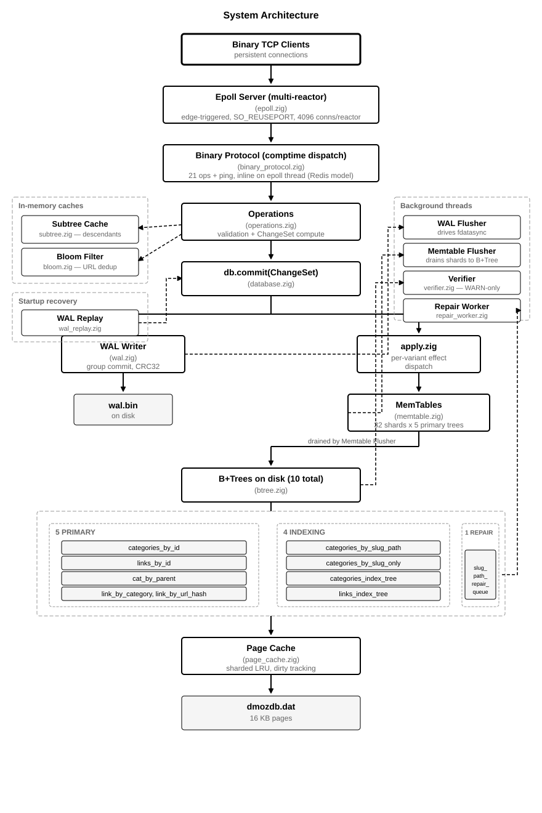
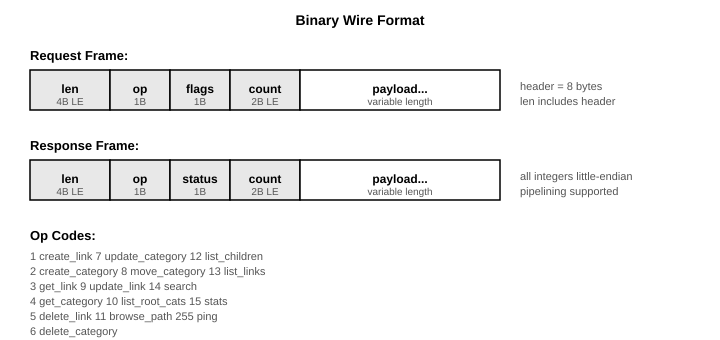
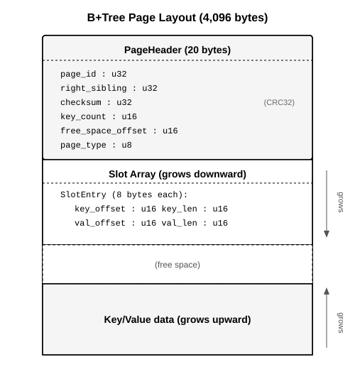
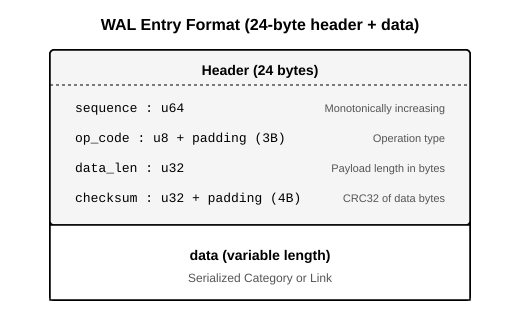
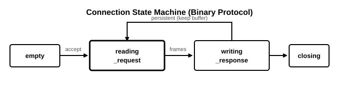
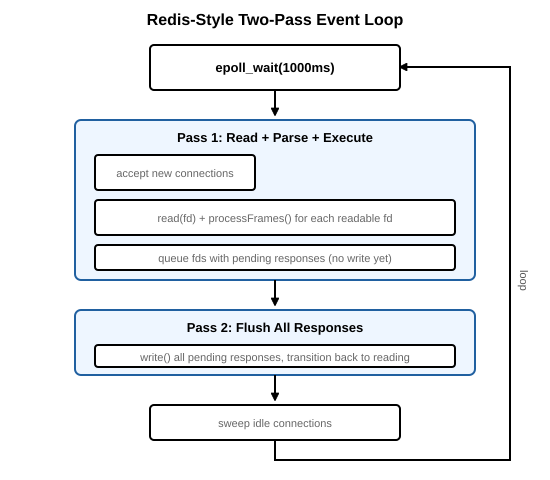
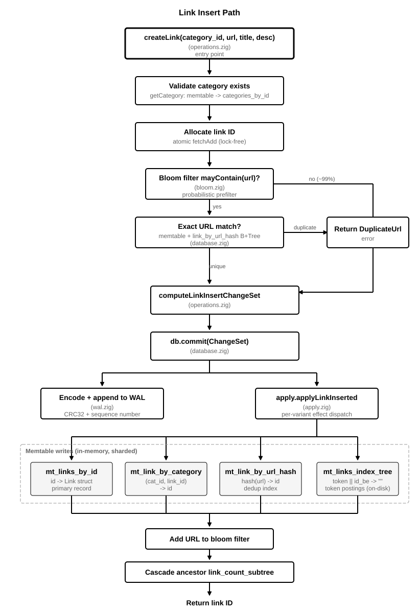
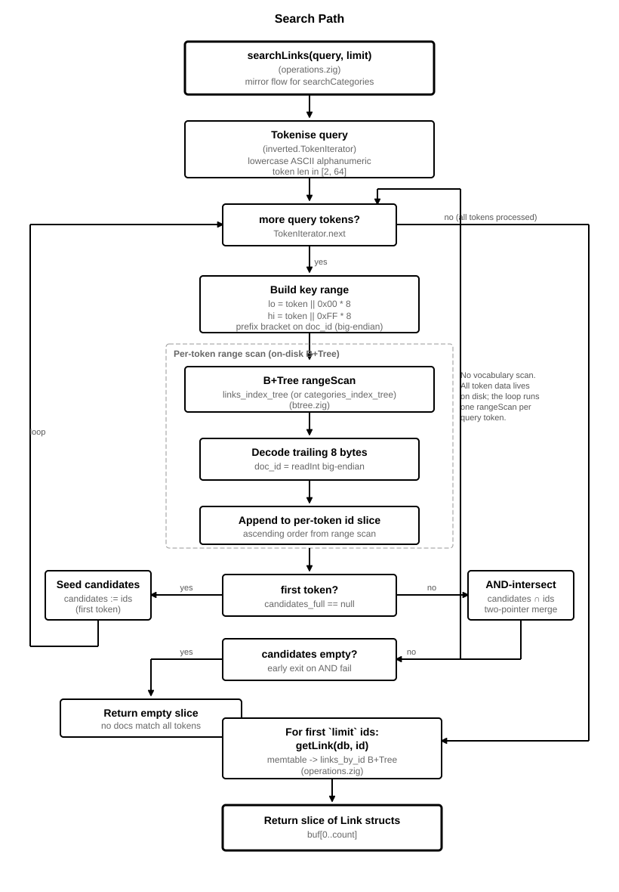

# zig-directory

A DMOZ-inspired web directory server, `dmozdb`, written in Zig. The storage engine (paged file, B+Trees, page cache,
WAL, snapshot, epoll reactor, protocol framing) is the external library [zigstore](https://github.com/poly-glot/zigstore);
this repository holds the directory schema, operations, ChangeSet apply logic, verifier, repair worker and the binary
protocol op handlers. Binary-only TCP protocol processed inline on the epoll thread (Redis model).

---

## Table of Contents

- [Features](#features)
- [Architecture](#architecture)
  - [System Overview](#system-overview)
  - [Engine](#engine)
  - [Storage Layout](#storage-layout)
  - [Network Layer](#network-layer)
  - [Durability](#durability)
- [Getting Started](#getting-started)
  - [Prerequisites](#prerequisites)
  - [Build from Source](#build-from-source)
  - [Run with Docker](#run-with-docker)
  - [Development Container](#development-container)
- [Configuration](#configuration)
- [Binary Protocol Reference](#binary-protocol-reference)
  - [Wire Format](#wire-format)
  - [Op Codes](#op-codes)
  - [Status Codes](#status-codes)
  - [Sub-Status Codes](#sub-status-codes)
  - [CRUD Operations](#crud-operations)
  - [Query Operations](#query-operations)
  - [Update Operations](#update-operations)
  - [Moderation Operations](#moderation-operations)
  - [System Operations](#system-operations)
- [Testing](#testing)
  - [Unit and Integration Tests](#unit-and-integration-tests)
  - [Load Testing](#load-testing)
- [Kubernetes Deployment](#kubernetes-deployment)
- [Project Structure](#project-structure)
- [Architecture Deep Dive](#architecture-deep-dive)
  - [B+Tree Index Engine](#btree-index-engine)
  - [Page Cache (Buffer Pool)](#page-cache-buffer-pool)
  - [Write-Ahead Log](#write-ahead-log)
  - [Slug Path Resolution](#slug-path-resolution)
  - [Slug-Path Repair Queue](#slug-path-repair-queue)
  - [Connection State Machine](#connection-state-machine)
  - [Event Loop](#event-loop)
  - [Link Insert Path](#link-insert-path)
  - [Search](#search)
- [Operational Guide](#operational-guide)
- [Contributing](#contributing)

---

## Features

- **zigstore engine**: 16 KB paged file, B+Trees, sharded LRU page cache with free-list management
- **Write-Ahead Log (WAL)** with group commit; a write is acknowledged only after `fdatasync`
- **Binary TCP protocol** with 32 ops + ping, processed inline on the epoll thread
- **Multi-reactor epoll** with edge-triggered non-blocking I/O and `SO_REUSEPORT`
- **Redis-style two-pass event loop**: read all, then write all
- **4,096 concurrent connections** per reactor with a per-connection state machine
- **Hierarchical categories** with slug-based path routing via on-disk B+Tree indices
- **Full-text search** across categories and links via posting-list B+Trees
- **Duplicate URL detection** via bloom filter + hash index
- **Moderation workflow**: pending / approved / rejected link status, per-submitter index, bulk status ops
- **Background verifier** and **slug-path repair worker** for large rename/move operations
- **Comptime-generic handlers**: payload parsing, batch create, get/delete and bitmask updates are each one helper reused across ops

---

## Architecture

### System Overview

<p align="center">
  
</p>

> Diagram source: [`diagrams/01-system-architecture.mmd`](diagrams/01-system-architecture.mmd)

### Engine

`dmozdb` is built on **zigstore** (`github.com/poly-glot/zigstore`, pinned in `build.zig.zon`, currently `v1.4.1`). The
library owns the generic machinery:

| zigstore module                      | Responsibility                                                            |
|--------------------------------------|---------------------------------------------------------------------------|
| `engine.zig`                         | `Engine(schema)`: page-0 header, named B+Trees, memtables, counters, recovery |
| `page.zig`, `btree/`, `freelist.zig` | 16 KB page format, B+Tree insert/search/delete/range scan, free-page chain |
| `page_cache.zig`                     | 64-shard LRU buffer pool with pin counting and dirty tracking             |
| `memtable.zig`                       | 32-shard in-memory write buffer per memtable-backed index                 |
| `wal.zig`, `wal_replay.zig`          | Group-commit WAL writer, `awaitDurable`, replay                           |
| `commit.zig`                         | `commit()`: WAL append → ordered apply → wait for fsync                   |
| `snapshot.zig`                       | `forceSnapshot` and the `snapshot.meta` superblock                        |
| `epoll.zig`, `connection.zig`, `run.zig` | Multi-reactor epoll server, connection slots, bootstrap               |
| `protocol/framing.zig`               | Request/response framing, `processFrames`, per-op latency histograms      |
| `server_config.zig`                  | `ServerConfig.fromEnv(prefix)`: port, bind, trusted IPs/CIDRs, sizing     |
| `bloom.zig`, `inverted_index.zig`, `codec.zig` | Bloom filter, tokenizer, `FixedString`, composite keys           |
| `tsgen.zig`                          | TypeScript client generator behind `zig build gen-client-ts`              |

This repository (`src/`) declares the directory schema (`zigstore.schema(...)` in `src/directory.zig`), the `Category` /
`Link` / `RepairTask` records, the operations, the `ChangeSet` type and its apply functions, the verifier, the repair
worker and the binary-protocol op handlers.

### Storage Layout

The store lives in `DMOZDB_DATA_DIR` as `store.dat` (16 KB pages), `wal.bin` and `snapshot.meta`:

- **Page 0**: file header (magic `DMOZ` / `0x444D4F5A`, `format_version` 5, a root page + entry count per index, the
  three ID counters `next_category_id`, `next_link_id`, `next_repair_seq`)
- **Pages 1+**: B+Tree nodes. Every root is allocated lazily on first insert and recorded in the header, so no page
  number is fixed beyond page 0

Eleven B+Trees back the read and write paths; the first six are also fronted by a memtable:

| Index                       | Key                       | Value                     | Memtable | Purpose                                            |
|-----------------------------|---------------------------|---------------------------|----------|----------------------------------------------------|
| `categories_by_id`          | category ID               | Category (1,288 bytes)    | yes      | Primary category lookup                            |
| `cat_by_parent`             | parent_id ++ child_id     | child ID                  | yes      | Hierarchy traversal                                |
| `links_by_id`               | link ID                   | Link (1,888 bytes)        | yes      | Primary link lookup                                |
| `link_by_category`          | category_id ++ link_id    | link ID                   | yes      | Links within a category                            |
| `link_by_url_hash`          | hash(url)                 | link ID                   | yes      | Duplicate URL detection                            |
| `link_by_submitter`         | submitter_id ++ link_id   | link ID                   | yes      | Links submitted by a user (op 27)                  |
| `categories_by_slug_path`   | full slug path            | category ID               | no       | Slug-path → ID resolution                          |
| `categories_by_slug_only`   | leaf slug                 | category ID               | no       | Leaf-slug → ID (shallowest holder)                 |
| `categories_index_tree`     | token ‖ category ID (BE)  | (empty)                   | no       | Posting list for category text search              |
| `links_index_tree`          | token ‖ link ID (BE)      | (empty)                   | no       | Posting list for link text search                  |
| `slug_path_repair_queue`    | repair_seq (BE)           | RepairTask (2,080 bytes)  | no       | Pending descendant slug-path cleanups              |

### Network Layer

- **Binary TCP protocol** on a single port (default 8080)
- **Multi-reactor epoll** with `SO_REUSEPORT`; `max(DMOZDB_THREAD_COUNT / 2, 1)` reactors
- **Edge-triggered events** (`EPOLLET`)
- **Redis-style two-pass event loop**: all reads processed before any writes
- **Inline frame processing**: ops run directly on the epoll thread
- **64 KiB request buffer**, **256 KiB response buffer** per connection
- **TCP_NODELAY** on every accepted socket

### Durability

Writes follow the WAL-first protocol via the ChangeSet pipeline:

1. **Compute**: `operations/operations_changeset_compute.zig` builds a typed `ChangeSet` describing every on-disk effect
   of the mutation (primary record, secondary indexes, ancestor count cascades, token entries).
2. **Commit**: `db.commit(cs)` calls `zigstore.commit`, which encodes the ChangeSet, appends it to the WAL as op `100`
   (CRC32 + monotonic sequence), applies it under the engine's apply mutex in sequence order, then blocks in
   `awaitDurable` until the group-commit flusher has `fdatasync`ed that sequence. **The ack is the fsync**: a handler
   does not return `ok` for a write until it is on disk.
3. **Apply**: `apply/*.zig` walks the ChangeSet variants. Effects on the six memtable-backed indexes go to that index's
   32-shard memtable; token entries and repair-queue writes go straight to their B+Trees; ancestor counts are rewritten
   synchronously in the same apply.
4. **Background drain**: the memtable flusher worker drains memtables into the B+Trees every 5 ms. Dirty pages sit in
   the page cache until a snapshot, an eviction or shutdown flushes them.
5. **Group commit**: the WAL flusher wakes every 2 ms or when `DMOZDB_WAL_BATCH_SIZE` entries (default 256) are
   pending, writes the batch and `fdatasync`s once.

There is no periodic snapshot scheduler. A snapshot (page-cache flush, header flush, then an atomic rewrite of the
64-byte `snapshot.meta` superblock recording the WAL sequence) happens only on op 22 `snapshot` or at the end of
`dmoz_import`.

On a clean shutdown the memtables are drained, the cache and header are flushed and `wal.bin` is truncated. On boot,
recovery replays the whole `wal.bin` from sequence 0 through the same `apply()` path, drains and flushes, then recomputes
category counts and link-status counts (which also reseeds the URL bloom filter from `links_by_id`). `snapshot.meta` is
only consulted to resume WAL sequence numbering after a truncate.

---

## Getting Started

### Prerequisites

- **Zig 0.15.2**: [install guide](https://ziglang.org/download/)
- **Docker** (optional, for containerized deployment)

### Build from Source

```bash
# Clone the repository
git clone <repo-url>
cd zig-directory

# Build the server (debug); produces zig-out/bin/dmozdb only
zig build

# Build the server plus the dev tools zig-out/bin/bench and zig-out/bin/dmoz_import
zig build -Dtools=true

# Build (optimized release)
zig build -Doptimize=ReleaseSafe

# Run tests
zig build test

# Run the server
DMOZDB_PORT=8080 DMOZDB_DATA_DIR=./data ./zig-out/bin/dmozdb
```

`bench` and `dmoz_import` are always compiled `ReleaseFast` regardless of `-Doptimize`. CI runs both `zig build test`
and `zig build -Dtools=true`.

### Run with Docker

The backend (Zig) and the web frontend (Deno/Fresh) build as two separate images.

```bash
# Build the backend image
docker build -f Dockerfile.backend -t dmozdb-backend:latest .

# Run the backend (binary protocol on 8080)
docker run -d \
  --name dmozdb \
  -p 8080:8080 \
  -v dmozdb-data:/var/lib/dmozdb \
  dmozdb-backend:latest

# Build the web frontend image
docker build -f Dockerfile.web -t dmozdb-web:latest .

# Run the web frontend (point it at the backend + a denokv instance)
docker run -d \
  --name dmozdb-web \
  -p 8000:8000 \
  -e DMOZDB_HOST=host.docker.internal -e DMOZDB_PORT=8080 \
  -e KV_PATH=http://host.docker.internal:4512 -e DENO_KV_ACCESS_TOKEN=dev-token \
  dmozdb-web:latest
```

### Development Container

The project includes a full [Dev Container](.devcontainer/devcontainer.json) configuration for VS Code and GitHub Codespaces:

- Ubuntu 24.04 with Zig 0.15.2 and ZLS pre-installed
- Docker-in-Docker enabled for container builds
- VS Code extensions: Zig language support, GitLens, ShellCheck
- Port 8080 auto-forwarded

| Alias   | Command                                                  | Description             |
|---------|----------------------------------------------------------|-------------------------|
| `zb`    | `zig build`                                              | Build the project       |
| `zt`    | `zig build test`                                         | Run all tests           |
| `zr`    | `zig build run`                                          | Run the server          |
| `zfmt`  | `zig fmt src/`                                           | Format all source files |
| `db`    | `docker build -f Dockerfile.backend -t dmozdb-backend .` | Build backend image     |
| `dbw`   | `docker build -f Dockerfile.web -t dmozdb-web .`         | Build web image         |
| `dr`    | `docker run --rm -p 8080:8080 dmozdb-backend`            | Run backend container   |

---

## Configuration

All configuration is via environment variables. Every setting has a default. The `DMOZDB_PORT` … `DMOZDB_TRUSTED` rows
are read by `zigstore.ServerConfig.fromEnv("DMOZDB_")`; the rest by `src/main.zig` and `src/directory.zig`.

| Variable                                  | Type   | Default           | Description                                                                 |
|-------------------------------------------|--------|-------------------|-----------------------------------------------------------------------------|
| `DMOZDB_PORT`                             | u16    | `8080`            | Binary protocol listen port                                                 |
| `DMOZDB_BIND`                             | IPv4   | `127.0.0.1`       | Address to bind the listen socket                                           |
| `DMOZDB_TRUSTED`                          | string | (none)            | Comma-separated IPv4 addresses and/or CIDRs (`10.0.0.5,10.244.0.0/16`) allowed to connect |
| `DMOZDB_CACHE_SIZE_MB`                    | u32    | `256`             | Page cache size in megabytes                                                |
| `DMOZDB_THREAD_COUNT`                     | u32    | auto              | 0 = CPU count (capped at 32); the server runs `max(n / 2, 1)` reactors      |
| `DMOZDB_SNAPSHOT_INTERVAL_S`              | u32    | `300`             | Parsed, currently unused: there is no periodic snapshot                     |
| `DMOZDB_WAL_SYNC_INTERVAL_MS`             | u32    | `50`              | Parsed, currently unused: the WAL flusher timer is a fixed 2 ms             |
| `DMOZDB_WAL_BATCH_SIZE`                   | u32    | `256`             | WAL entries that trigger an immediate group flush                           |
| `DMOZDB_DATA_DIR`                         | string | `/var/lib/dmozdb` | Directory for `store.dat`, `wal.bin`, `snapshot.meta`                       |
| `DMOZDB_RENAME_INLINE_THRESHOLD`          | u32    | `5000`            | Subtree size at which rename/move flips from in-line strict to queued async repair |
| `DMOZDB_REPAIR_WORKER_INTERVAL_MS`        | u32    | `1000`            | Repair-worker tick interval (ms)                                            |
| `DMOZDB_REPAIR_WORKER_CHUNK_SIZE`         | u32    | `10000`           | Descendants processed per worker chunk                                      |
| `DMOZDB_SUBTREE_SCAN_THRESHOLD`           | u32    | `1024`            | Descendant count above which `list_subtree_links` uses the sequential `link_by_category` scan instead of per-descendant range scans |
| `DMOZDB_VERIFIER_INTERVAL_S`              | u32    | `300`             | Seconds between background verifier runs                                    |

---

## Binary Protocol Reference

### Wire Format

<p align="center">
  
</p>

> Diagram source: [`diagrams/05-binary-wire-format.mmd`](diagrams/05-binary-wire-format.mmd)

Requests carry an 8-byte header, responses a 10-byte header. All integers are little-endian. `len` includes the header.
Multiple frames can be pipelined on the same persistent TCP connection.

```
Request:  [u32 len][u8 op][u8 reserved][u16 count][payload...]
Response: [u32 len][u8 op][u8 status][u8 sub_status][u8 pad][u16 count][payload...]
```

`count` is the number of items in a batch request, and the number of rows in a list response.

### Op Codes

| Code   | Op                        | Batch   | Description                                                              |
|--------|---------------------------|---------|--------------------------------------------------------------------------|
| 1      | `create_link`             | yes     | Create links (count items)                                               |
| 2      | `create_category`         | yes     | Create categories (count items)                                          |
| 3      | `get_link`                | no      | Get link by ID                                                           |
| 4      | `get_category`            | no      | Get category by ID                                                       |
| 5      | `delete_link`             | no      | Delete link by ID                                                        |
| 6      | `delete_category`         | no      | Delete category by ID                                                    |
| 7      | `update_category`         | no      | Update category fields (bitmask)                                         |
| 8      | `move_category`           | no      | Move category to new parent                                              |
| 9      | `update_link`             | no      | Update link fields (bitmask)                                             |
| 10     | `list_root_categories`    | no      | List root categories with pagination                                     |
| 11     | `browse_path`             | no      | Resolve a slug path: category, ancestors, children, subtree link count   |
| 12     | `list_children`           | no      | List child categories with pagination                                    |
| 13     | `list_links`              | no      | List links in a category; optional status filter and cursor              |
| 14     | `search`                  | no      | Full-text search categories and links                                    |
| 15     | `stats`                   | no      | Database statistics                                                      |
| 16     | `list_all_links`          | no      | List links across all categories; optional status filter and cursor      |
| 17     | `list_subtree_links`      | no      | List links in a subtree (transitive over all descendants) with pagination |
| 18     | `index_health`            | no      | Verifier snapshot + slug-path repair queue depth + worker counters        |
| 19     | `run_verifier`            | no      | Run the verifier inline, then return the `index_health` frame            |
| 20     | `rebuild_index`           | no      | Rebuild the category and link secondary indexes, drain the repair queue  |
| 22     | `snapshot`                | no      | Flush cache + header and write `snapshot.meta`                           |
| 23     | `op_latency_stats`        | no      | Per-op latency percentiles since boot                                    |
| 24     | `bulk_import`             | yes     | Insert up to 50,000 links from one frame (importer path)                 |
| 25     | `create_submission`       | no      | Create a link with status `pending` and a submitter ID                   |
| 26     | `update_link_status`      | no      | Set one link's status                                                    |
| 27     | `list_links_by_submitter` | no      | List a submitter's links; optional status filter and cursor              |
| 28     | `move_link`               | no      | Move a link to another category                                          |
| 29     | `get_categories_by_ids`   | no      | Fetch up to 200 categories by ID                                         |
| 30     | `breadcrumbs_by_ids`      | no      | Ancestor chains (id, name, slug) for up to 200 categories                |
| 34     | `bulk_update_link_status` | no      | Set status on up to 200 links, per-item result codes                     |
| 35     | `bulk_delete_links`       | no      | Delete up to 200 links, per-item result codes                            |
| 36     | `counts_by_status`        | no      | Link counts per status                                                   |
| 255    | `ping`                    | no      | Ping/pong                                                                |

Codes 21 and 31–33 are unassigned.

### Status Codes

| Code   | Status               | Meaning                              |
|--------|----------------------|--------------------------------------|
| 0      | `ok`                 | Success                              |
| 1      | `not_found`          | Resource not found                   |
| 2      | `duplicate`          | Duplicate URL                        |
| 3      | `invalid`            | Invalid request payload              |
| 4      | `err`                | Internal error                       |
| 5      | `category_not_found` | Category does not exist              |
| 6      | `has_children`       | Cannot delete: category has children |
| 7      | `circular`           | Circular hierarchy detected          |

### Sub-Status Codes

`sub_status` refines `status`; it is `none` unless listed here.

| Code   | Sub-status            | Paired with          | Meaning                                              |
|--------|-----------------------|----------------------|------------------------------------------------------|
| 0      | `none`                | any                  | No refinement                                        |
| 1      | `field_too_long`      | `invalid`            | A string exceeds its `FixedString` capacity, or a `bulk_import` frame exceeds its caps |
| 2      | `invalid_slug`        | `invalid`            | Slug fails validation                                |
| 3      | `buffer_too_small`    | `invalid`            | Response would not fit the connection buffer         |
| 4      | `path_too_deep`       | `invalid`            | Category depth limit exceeded                        |
| 5      | `unsupported_order`   | `invalid`            | `list_subtree_links` order code other than 0, or an unknown link status byte |
| 6      | `parent_not_found`    | `category_not_found` | Parent category missing on create/move               |
| 7      | `duplicate_url`       | `duplicate`          | URL already stored                                   |
| 8      | `offset_too_large`    | `invalid`            | `list_subtree_links` offset above 5000               |
| 9      | `already_in_progress` | `err`                | A snapshot is already running                        |
| 10     | `duplicate_slug`      | `duplicate`          | A sibling category already has that slug (create, rename, or move) |

### CRUD Operations

**Create link (op=1, batch)**
```
Request payload per item:
  [u64 category_id][u16 url_len][url][u16 title_len][title][u16 desc_len][desc]

Response per item (count = items written):
  [u8 status][u8 sub_status][u64 link_id]
```

**Create category (op=2, batch)**: same layout with `[u64 parent_id][name][slug][desc]`.

**Get link/category (op=3/4)**
```
Request:  [u64 id]
Response: [full extern struct bytes]   (Link=1888B, Category=1288B)
```

**Get categories by IDs (op=29)**
```
Request:  [u16 n (<= 200)][n x u64 id]
Response: header (count=found) + [found x Category struct bytes]   (missing IDs are skipped)
```

**Delete link/category (op=5/6)**
```
Request:  [u64 id]
Response: header only (status in header)
```

### Query Operations

**List root categories (op=10)**
```
Request:  [u32 offset][u32 limit]
Response: header (count=N) + [N x Category struct bytes]
```

**List children (op=12)**
```
Request:  [u64 parent_id][u32 offset][u32 limit]
Response: header (count=N) + [N x Category struct bytes]
```

**List links (op=13)**, **list all links (op=16)**, **list links by submitter (op=27)**
```
Request (op=13): [u64 category_id][u32 offset][u32 limit][extras]
Request (op=16): [u32 offset][u32 limit][extras]
Request (op=27): [u64 submitter_id][u32 offset][u32 limit][extras]

extras, optional trailing bytes:
  (none)                      no status filter, offset pagination
  [u8 status]                 filter by status 0=pending 1=approved 2=rejected
  [u8 status][u64 after_id]   status 0xFF = no filter; after_id > 0 = cursor pagination

Response: header (count=N) + [N x Link struct bytes][u64 next_after_id]
```

`limit` is capped by a 128 KiB row budget: 69 links per page (100 for category lists). `next_after_id` is 0 when
there is no further page.

**List subtree links (op=17)**
```
Request:  [u64 category_id][u8 order_code (must be 0)][u32 offset (<= 5000)][u32 limit][extras as above]
Response: [u32 written][written x Link struct bytes][u64 total][u64 next_after_id]   (header count=0)
```

`limit` 0 means 50; the maximum is 100. `total` is the subtree link count under the status filter.

**Browse path (op=11)**
```
Request:  [u16 path_len][path]   e.g. "top/computers/programming"
Response: [Category bytes][u16 ancestor_count][ancestors...][u16 child_count][children (<= 100)...][u64 total_links]
```

Ancestors are ordered root-first. `total_links` is the transitive link count of the subtree.

**Breadcrumbs by IDs (op=30)**
```
Request:  [u16 n (<= 200)][n x u64 id]
Response: header (count=n) + per id: [u16 crumb_count][crumb_count x ([u64 id][66B name][130B slug])]
```

Each crumb list runs root-first and ends with the category itself; an unknown ID yields `crumb_count=0`.

**Search (op=14)**
```
Request:  [u16 query_len (>= 2)][query][u32 limit][optional u8 scope: 0=both 1=links_only 2=categories_only]
Response: [u16 cat_count][categories...][u16 link_count][link_count x ([Link bytes][u8 match_field])]
```

`limit` is capped at 50 per kind. `match_field` is 0=title, 1=url, 2=description.

### Update Operations

Update ops use a **bitmask byte** to indicate which fields are present.

**Update category (op=7)**
```
Request:  [u64 id][u8 bitmask][...present fields...]

Bitmask bits:
  0x01 = name    -> [u16 len][bytes]
  0x02 = slug    -> [u16 len][bytes]
  0x04 = desc    -> [u16 len][bytes]
```

**Update link (op=9)**: same pattern with `0x01=url`, `0x02=title`, `0x04=desc`.

**Move category (op=8)**
```
Request:  [u64 category_id][u64 new_parent_id]
```

**Move link (op=28)**
```
Request:  [u64 link_id][u64 new_category_id]
```

### Moderation Operations

Link status is a `u8`: `0=pending`, `1=approved`, `2=rejected`. `create_link` stores `approved`.

**Create submission (op=25)**
```
Request:  [u64 category_id][u16 url_len][url][u16 title_len][title][u16 desc_len][desc][u64 submitter_id]
Response: header (count=1) + [u8 status][u8 sub_status][u64 link_id]
```

**Update link status (op=26)**
```
Request:  [u64 link_id][u8 status]
```

**Bulk update link status (op=34)** and **bulk delete links (op=35)**
```
Request (op=34): [u8 status][u16 n (<= 200)][n x u64 link_id]
Request (op=35): [u16 n (<= 200)][n x u64 link_id]
Response: [u16 ok_count][u16 err_count][n x ([u64 link_id][u8 code])]

code: 0=ok 1=not_found 2=already_in_state 3=invalid_transition
```

**Counts by status (op=36)**
```
Response: [u64 pending][u64 approved][u64 rejected]
```

### System Operations

**Stats (op=15)**
```
Response: [u64 category_count][u64 link_count][u64 page_count]
          [u64 cache_hits][u64 cache_misses][u64 wal_pending]
```

**Index health (op=18)**
```
Response: header + state snapshot + repair-queue surface
  [i64 last_run_at][u8 index_count][N x (u8 name_len, name, u64 expected, u64 observed, u32 drift_bp)]
  [u64 slug_path_repair_queue_depth]
  [i64 slug_path_repair_worker_last_tick_ms]
  [u64 slug_path_repair_worker_tasks_processed]
  [u64 slug_path_repair_worker_chunks_processed]
```

**Run verifier (op=19)**: runs `verifier.runOnce` inline on the reactor thread and returns the refreshed `index_health`
frame. A failure is logged and the previous snapshot is returned.

**Rebuild index (op=20)**
```
Response: [u64 categories_rebuilt][u64 links_rebuilt][u64 queue_entries_drained]
```

**Snapshot (op=22)**
```
Response: [u64 wal_sequence][u64 duration_ms]
```

Returns `err` / `already_in_progress` if another snapshot is running.

**Op latency stats (op=23)**
```
Response: [u8 n][n x ([u8 op][u64 p50][u64 p95][u64 p99][u64 p99_9][u64 max][u64 mean][u64 samples])]
```

Latencies are nanoseconds; ops with no samples are omitted.

**Bulk import (op=24)**
```
Request:  count items in the create_link layout; payload <= 60 KiB, count <= 50,000
Response: [u64 inserted][u64 duplicates][u64 errors][u64 first_id][u64 last_id][u64 elapsed_ms]
```

**Ping (op=255)**: empty request, empty response with `status=ok`.

---

## Testing

### Unit and Integration Tests

```bash
zig build test
```

This compiles the test graph rooted at `src/main.zig`, which pulls in every module under `src/`:

- **Schema**: `Category` / `Link` / `RepairTask` sizes and round-trips, composite keys
- **ChangeSet**: encode/decode of every effect variant
- **Apply**: effect handlers, ancestor count cascades, token writes, repair-queue writes
- **Operations**: categories (CRUD, hierarchy, circular-move rejection), links (CRUD, duplicate URL, status counts),
  slug-path resolution and validation gate, search (AND intersection), subtree listing
- **Binary protocol**: payload parsing, sub-status mapping, response headers, `list_subtree_links`, `snapshot`,
  `op_latency_stats`, `stats`
- **Directory**: header round-trips, counters across reopen, recovery boot path
- **Verifier and repair worker**: drift detection, queue drain
- **E2E** (`src/e2e_test.zig`): full workflows against a temp data dir, crash-and-replay (an acked commit survives an
  unclean crash), bloom reseed after restart, snapshot persistence

The engine's own tests (page format, B+Tree, page cache, free list, WAL, connection, framing) live and run in the
zigstore repository.

### Load Testing

The `bench` harness (in `bench/`) covers eight workloads with p50 / p95 / p99 / p99.9 latency percentiles, throughput,
and RSS sampling, emitted as JSON Lines for cross-run comparison. It runs unconstrained or under cgroup-enforced
1 CPU / 2 GB and 2 CPU / 4 GB profiles via `systemd-run` wrappers.

```bash
zig build -Dtools=true

# 1. Start the server, seed a deterministic fixture
mkdir -p /tmp/bench-data
DMOZDB_DATA_DIR=/tmp/bench-data ./zig-out/bin/dmozdb &
./zig-out/bin/bench seed --data-dir /tmp/bench-data --categories 1000 --links 100000

# 2. Run a write hammer
./zig-out/bin/bench create_link --workers 4 --batch 10 --ops-per-worker 20000 --output bench.jsonl

# 3. Run a constrained read sweep
./bench/run-constrained.sh 1cpu2gb -- get_link \
  --data-dir /tmp/bench-data --workers 4 --ops-per-worker 5000 --output bench.jsonl

# 4. Inspect
jq '[.profile, .workload, .latency_ns.p50, .latency_ns.p99, .ops_per_sec] | @tsv' bench.jsonl
```

Subcommands: `seed`, `create_link`, `bulk_import`, `get_link`, `browse --kind {path|children|subtree-links}`,
`search --target {links|categories}`, `mixed --read-pct PCT`, `cold --kind {cache|boot} --server-cmd CMD`. See
[`bench/README.md`](bench/README.md) for the full reference, the matrix-runner example, and the JSON Lines schema.

---

## Kubernetes Deployment

The live deployment is `deployment/`, applied with kustomize.

```bash
kubectl apply -k deployment/overlays/main
```

`.github/workflows/cd.yaml` does this on every push to `main`, rewriting each
image tag to the built commit SHA first. Three workloads come out of it: the
Zig backend (StatefulSet), the Deno/Fresh frontend (Deployment + HPA) and the
MCP server (Deployment), behind one Traefik Ingress on
`directory.junaid.guru`, with `/mcp` and `/.well-known/oauth-protected-resource`
routed to the MCP service and everything else to the frontend.

### Secrets, which must exist before the first apply

Two Secrets are referenced by the manifests and created by nobody: not by
kustomize, not by CD. A missing one does not fail the deploy: `kubectl apply`
succeeds, the workflow goes green, and the pod sits in
`CreateContainerConfigError` until someone looks. Create both in the namespace
before the first rollout.

```bash
kubectl create namespace dmozdb

# Deno KV access token, shared by the denokv StatefulSet and the frontend.
kubectl create secret generic denokv-auth -n dmozdb \
  --from-literal=token="$(openssl rand -hex 32)"

# RS256 keypair the frontend signs MCP access tokens with, and verifies them
# against. The MCP server never sees it: it fetches the public half from the
# frontend's JWKS endpoint. Generate a keypair that is not the one in web/.env.
cd web && deno run -A scripts/generate-jwt-keypair.ts
```

That script prints the two values in `.env` form. For the cluster, write each
to a file and load it as a key: `private-key-pem` tolerates real newlines, and
`public-key-jwk` is the JSON object:

```bash
kubectl create secret generic mcp-jwt-signing-key -n dmozdb \
  --from-file=private-key-pem=./private-key-pem \
  --from-file=public-key-jwk=./public-key-jwk
```

Rotating the keypair invalidates every access token already issued, which is
usually what you want and never silent: clients get a `401 invalid_token` and
re-run their sign-in.

The image-pull Secret (`ocirsecret`) is the exception: CD copies it into the
namespace itself on every run.

### What the manifests provide

- **StatefulSet**: 10Gi persistent volume at `/var/lib/dmozdb`, 512Mi-2Gi RAM,
  250m-1500m CPU
- **Frontend**: 2-4 replicas via HPA at 70% CPU, readiness gated on backend
  reachability
- **MCP**: one replica deliberately; the transport is session-oriented with no
  shared session store, so a second would strand sessions that do not land back
  on their own pod

---

## Project Structure

```
zig-directory/
├── src/
│   ├── main.zig                          Entry point, Config.fromEnv, test root
│   ├── directory.zig                     zigstore.schema literal, Directory (commit, recover, workers, shutdown)
│   ├── schema.zig                        Category, Link, RepairTask extern structs, composite keys
│   ├── binary_protocol.zig               Op / Status / SubStatus enums, dispatch, one handler per op
│   ├── changeset.zig                     Typed ChangeSet effects + encoder/decoder (WAL op 100)
│   ├── subtree.zig                       Descendant collection and cache for browse_path / list_subtree_links
│   ├── verifier.zig                      Background invariant verifier (warn-only)
│   ├── e2e_test.zig                      End-to-end tests against a temp data dir
│   ├── gen_client_ts.zig                 Driver for `zig build gen-client-ts`
│   ├── import_main.zig                   dmoz_import: TSV importer (snapshot + WAL truncate at the end)
│   ├── apply/
│   │   ├── apply.zig                     ChangeSet dispatcher, ancestor cascades, token writes
│   │   ├── apply_category.zig            Category effect handlers
│   │   ├── apply_link.zig                Link effect handlers
│   │   └── apply_repair.zig              Slug-path repair effect handlers
│   ├── operations/
│   │   ├── operations.zig                Public operations surface
│   │   ├── operations_shared.zig         Field limits, errors, helpers
│   │   ├── operations_changeset_compute.zig  Builds a ChangeSet per mutation
│   │   ├── operations_category.zig       Category CRUD, move, listing, ancestors
│   │   ├── operations_link.zig           Link CRUD, status, duplicate check, status recount
│   │   ├── operations_search.zig         Posting-list search with AND intersection
│   │   └── operations_slug.zig           Slug validation and slug-path resolution
│   ├── repair/
│   │   ├── repair.zig                    rebuild_index (op 20)
│   │   └── repair_worker.zig             Background drain of slug_path_repair_queue
│   └── wal/
│       └── wal_apply.zig                 WAL replay: decode op 100 and apply
├── bench/                                Benchmark client (zig build -Dtools=true), cgroup wrappers, baselines
│   ├── main.zig, common.zig
│   ├── workloads/                        seed, create_link, bulk_import, get_link, browse, search, mixed, cold
│   ├── run-constrained.sh, run-server-constrained.sh
│   └── README.md
├── web/                                  Deno/Fresh frontend; web/lib/dmoz-protocol.gen.ts is generated
├── mcp/                                  FastMCP server over the frontend's /api/v1
├── e2e/                                  Playwright suite for the web frontend
├── k6/                                   k6 stress script
├── scripts/                              migrate-kv.ts
├── deployment/                           Live kustomize manifests (base/, overlays/main, metrics-server/)
├── diagrams/                             Architecture diagrams (SVG + Mermaid sources)
├── data/                                 Sample store (store.dat.zip)
├── .devcontainer/                        Dev Container configuration
├── .github/workflows/                    ci.yaml, cd.yaml
├── build.zig                             Build: dmozdb, test, gen-client-ts; -Dtools=true adds bench + dmoz_import
├── build.zig.zon                         Package manifest; pins zigstore
├── Dockerfile.backend                    Backend (Zig) container image
├── Dockerfile.web                        Web frontend (Deno/Fresh) container image
├── Dockerfile.mcp                        MCP server container image
└── entrypoint.backend.sh                 Backend container entrypoint
```

---

## Architecture Deep Dive

### B+Tree Index Engine

The B+Tree implementation (`btree/` in zigstore) is the core of the storage engine.

**Page layout** (16,384 bytes per page):

<p align="center">
  
</p>

Key properties:

- **Leaf nodes** store key-value pairs directly; linked via `right_sibling` for efficient range scans
- **Internal nodes** store keys with child page pointers for tree navigation
- **Max tree depth**: 32 levels
- **Keys**: variable-length byte slices, compared lexicographically
- **Composite keys** use big-endian encoding to preserve sort order (e.g., `parent_id ++ child_id`)
- **Page types**: leaf (0), internal (1), overflow (2), free (3)

### Page Cache (Buffer Pool)

The page cache (`page_cache.zig` in zigstore) keeps frequently accessed pages in memory:

- **Configurable size**: default 256 MB = 16,384 pages
- **Eviction policy**: LRU per shard with pin counting; pinned pages cannot be evicted
- **Dirty tracking**: pages fetched for mutation are marked dirty and written back on snapshot, eviction or shutdown
- **Thread-safe**: 64 shards keyed by page ID, each behind its own `std.Thread.Mutex`
- **Atomic stats**: `hit_count` and `miss_count` use `std.atomic.Value` for lock-free reads

### Write-Ahead Log

The WAL (`wal.zig` in zigstore) provides crash recovery with group commit batching.

**Entry format** (24-byte header + variable-length data):

<p align="center">
  
</p>

```
[u64 sequence][u8 op_code][3B pad][u32 data_len][u32 crc32(data)][4B pad][data...]
```

dmozdb writes a single WAL op code, `100`, whose data is an encoded `ChangeSet`. The ChangeSet carries its own effect
tags (`link_inserted`, `link_deleted`, `link_text_updated`, `link_recategorized`, `category_inserted`,
`category_deleted`, `category_text_updated`, `category_renamed`, `category_moved`, `slug_path_repair_chunk`,
`slug_path_repair_complete`), so replay and live apply share one decoder and one `apply()`.

**Group commit**: the flusher thread wakes when the batch reaches `DMOZDB_WAL_BATCH_SIZE` (default 256) or after a
fixed 2 ms, writes every pending entry and issues one `fdatasync`. Each committing handler waits in `awaitDurable` for
its sequence to pass that fsync. If an fsync fails, `fsync_failed` is set and stays set: every later commit returns
`error.WalFlushFailed` until the process restarts.

### Slug Path Resolution

Category slugs form a hierarchical namespace (e.g., `computers/programming/zig`). Path lookups are served by two B+Trees populated atomically on every category mutation:

- **`categories_by_slug_path`** maps the full hierarchical path → cat_id. Used by `browse_path` and `resolveSlugPath`. Maintained inline by every category create/delete/rename/move.
- **`categories_by_slug_only`** maps a leaf slug → the shallowest cat_id holding that slug. Used as a single-segment fallback for short URLs.

A `resolveSlugPath` lookup is one B+Tree search in steady state. During the post-rename/move repair window (when `slug_path_repair_queue.entry_count > 0`), the resolver also walks the resolved cat's parent chain to confirm the canonical path matches the queried path; see [Slug-Path Repair Queue](#slug-path-repair-queue).

### Slug-Path Repair Queue

A **rename or move of a non-leaf category** invalidates every descendant's stored full slug path. For small subtrees the rewrite is cheap and happens atomically inside the rename's ChangeSet apply. For large subtrees (e.g. `Top/Regional` with 10⁵ descendants) the in-line rewrite would hold the apply mutex for seconds; the database instead defers the cleanup to a dedicated background worker.

**Threshold.** `DMOZDB_RENAME_INLINE_THRESHOLD` (default 5000) selects between the two paths. The compute step walks descendants depth-first, capped at `threshold + 1`, to detect breach without scanning the entire subtree.

**Below threshold (atomic).** The rename/move ChangeSet carries a list of `(old_path, new_path, cat_id)` swaps. `applyCategoryRenamed` / `applyCategoryMoved` delete-then-insert each pair on `categories_by_slug_path` in the same `db.commit()` as the primary record update. No queue write.

**Above threshold (queued).** The ChangeSet carries an `EnqueueOnApply` payload with a fresh `repair_seq`. Apply writes a `RepairTask` record (2,080 bytes: `cat_id`, op, timestamp, old slug prefix) to `slug_path_repair_queue` keyed by big-endian seq. The renamed cat itself is updated atomically; its descendants stay stale until the worker drains them.

**Repair worker (`src/repair/repair_worker.zig`).** Started by `Directory.startBackgroundThreads()`. Each tick (`DMOZDB_REPAIR_WORKER_INTERVAL_MS`, default 1 s) it pops the min-key task, walks the cat's descendants via `cat_by_parent`, and emits chunked `slug_path_repair_chunk` ChangeSets (`DMOZDB_REPAIR_WORKER_CHUNK_SIZE` descendants per chunk, default 10000) until the walk completes. Each chunk is its own `db.commit()`, so progress is WAL-durable. After the final chunk, a `slug_path_repair_complete` removes the queue entry. Crash mid-walk is idempotent: the queue entry survives until the final commit, and chunk emission checks the old path still exists before scheduling a swap.

**Read-side validation.** `resolveSlugPath` short-circuits when `slug_path_repair_queue.entry_count == 0`, so there is no extra cost in steady state. When the queue is non-empty, every resolve walks the resolved cat's parent chain and confirms its current canonical path matches the query; mismatch returns `not_found`. Stale paths are hidden from clients during the window, never returning a wrong cat_id.

**Operator visibility.** Op 18 `index_health` response includes the queue depth, worker last-tick timestamp, total tasks processed, and total chunks processed. The worker logs at `info` per task and at `warn` when queue depth crosses 100 / 1 000 / 10 000.

### Connection State Machine

Each of the 4,096 connection slots (`connection.zig` in zigstore) progresses through phases:

<p align="center">
  
</p>

> Diagram source: [`diagrams/04-connection-state-machine.mmd`](diagrams/04-connection-state-machine.mmd)

- **reading_request**: edge-triggered `EPOLLIN` drains all available data into the 64 KiB request buffer
- **writing_response**: response is flushed to the socket; on completion, transitions back to `reading_request` (persistent connections keep their buffer)
- **closing**: socket is removed from epoll and closed; the slot is reset to `empty`

Binary connections are persistent: after writing a response, the connection loops back to reading without releasing its buffer or re-arming epoll.

### Event Loop

The epoll event loop uses a two-pass design inspired by Redis:

<p align="center">
  
</p>

> Diagram source: [`diagrams/06-event-loop.mmd`](diagrams/06-event-loop.mmd)

**Pass 1 (read)**: Process all readable events: accept connections, read data, parse and execute binary protocol frames inline. Connections with pending responses are queued but not written yet.

**Pass 2 (write)**: Flush all pending responses in one batch. Most writes complete inline (TCP send buffer is rarely full for small response frames). If `write()` returns `WouldBlock`, the connection is armed for `EPOLLOUT` to retry later.

This eliminates the per-request `epoll_ctl MOD` syscall overhead that occurs when alternating between read and write arming on each request.

### Link Insert Path

Creating a link is one synchronous call on the reactor thread that ends with a durable WAL entry.

<p align="center">
  
</p>

> Diagram source: [`diagrams/07-link-insert-path.mmd`](diagrams/07-link-insert-path.mmd)

The steps in detail:

**1. Validate.** Field lengths are checked against the limits in `operations_shared.zig` (URL 64, title 128, description 256 bytes; `FieldTooLong` otherwise), then the target category must exist. `getCategory` checks the memtable first, then falls through to the `categories_by_id` B+Tree. A missing category returns `CategoryNotFound` without side effects.

**2. Duplicate URL check.** Three tiers, cheapest first. The bloom filter (lock-free atomic bit reads) rejects most unique URLs immediately. On a possible hit, the `link_by_url_hash` memtable is consulted, then the B+Tree. A hash match is confirmed by comparing the stored link's URL bytes, so only a true byte-level match returns `DuplicateUrl`.

**3. Allocate link ID.** `next_link_id.fetchAdd(1)`. This happens after the duplicate check, so a rejected duplicate does not burn an ID.

**4. Compute the ChangeSet.** `computeLinkInsertChangeSet` produces a `link_inserted` effect carrying the `Link` record, its tokens (title, URL, description through `inverted_index.TokenIterator`: lowercase ASCII alphanumeric runs of length 2–64) and the ancestor count updates.

**5. Commit.** `db.commit(cs)` appends the encoded ChangeSet to the WAL, then applies it under the apply mutex:
`link_by_category`, `link_by_url_hash`, `link_by_submitter` (when `submitter_id != 0`) and `links_by_id` receive memtable puts; the token rows `(token ‖ link_id_be) → ""` go straight into `links_index_tree`; every ancestor's `link_count_subtree` (and the direct category's `link_count`) is rewritten through the `categories_by_id` memtable; the URL is added to the bloom filter; the status counter is bumped; the subtree cache is invalidated.

**6. Wait for durability.** `commit` blocks in `awaitDurable` until the WAL flusher has `fdatasync`ed the entry, then the handler writes `[ok][none][link_id]` into the response. Write latency is therefore bounded below by one group-commit cycle.

### Search

Full-text search is served by two on-disk B+Trees: `categories_index_tree` and `links_index_tree`. Each tree's keys are `(token bytes ‖ document_id_be)` with empty values; a range scan over `(token ‖ 0) .. (token ‖ MAX)` returns every document id whose text contains the token. There is no in-memory inverted index.

<p align="center">
  
</p>

> Diagram source: [`diagrams/08-search-path.mmd`](diagrams/08-search-path.mmd)

**Tokenisation.** The query string runs through the same `inverted_index.TokenIterator` used at write time: lowercase ASCII alphanumeric runs of length [2, 64]. Identical tokenisation at write and search guarantees byte-identical matches.

**Per-token posting list.** For each query token the search emits one B+Tree range scan, accumulating document IDs. Posting lists are sorted by ID, so results stream in order without an explicit sort.

**AND-of-tokens intersection.** When the query has multiple tokens, the search intersects the posting lists, yielding only documents that contain every token. The first posting list serves as the candidate set; subsequent posting lists prune it. The query "green solutions" returns documents containing both tokens, not either-or.

**Materialisation.** The first `limit` (at most 50) surviving IDs are hydrated via `getLink` / `getCategory` (memtable → primary B+Tree). Documents that no longer exist (deleted between indexing and search) are silently skipped. Each link row carries a `match_field` byte telling the client whether the title, URL or description matched.

**What the search does not do.** There is no relevance ranking: results are returned in ID order. No TF-IDF, no BM25, no field boosting, no phrase queries or fuzzy matching. Non-ASCII characters are not lowercased; a search for "blüm" will not match a document containing "Blüm" because the tokeniser only handles ASCII case folding.

---

## Operational Guide

### Data Files

The server creates these files in `DMOZDB_DATA_DIR`:

| File            | Purpose                                                                 |
|-----------------|-------------------------------------------------------------------------|
| `store.dat`     | Main data file (16 KB pages: header + B+Tree nodes)                     |
| `wal.bin`       | Write-ahead log (append-only; truncated on clean shutdown)              |
| `snapshot.meta` | 64-byte superblock written by op 22 / `dmoz_import`; records the WAL sequence at that point |

### Monitoring

Use the `stats` binary protocol op (op=15) to query runtime metrics, and `op_latency_stats` (op=23) for per-op percentiles:

| Metric                          | What to watch                                                            |
|---------------------------------|--------------------------------------------------------------------------|
| `cache_hits` / `cache_misses`   | Compute hit rate; below 80% means cache is too small                     |
| `page_count`                    | Total pages allocated; growth rate reflects write volume                 |
| `wal_pending`                   | Entries waiting to flush; consistently high means writes outpace flushes |
| `category_count` / `link_count` | Total stored objects                                                     |

### Graceful Shutdown

The server handles `SIGINT` and `SIGTERM` via a self-pipe that wakes the epoll loop:

1. Signal handler sets an atomic flag and writes a byte to the self-pipe
2. Epoll loop wakes, detects the shutdown fd, and exits
3. Background workers (memtable flusher, verifier, repair worker) are stopped
4. Memtables are drained into the B+Trees and all dirty cache pages are flushed
5. File header is persisted (page count, root page pointers, entry counts, ID counters)
6. `wal.bin` is truncated, but only if steps 4 and 5 succeeded; otherwise it is kept for replay on the next boot
7. All connections are closed

### Backup

There is no online backup. Either stop the server, or take a snapshot (op 22) and copy immediately after it returns;
`snapshot.meta` on its own is not a backup.

```bash
# Stop the server for a consistent backup
kill -TERM $(pidof dmozdb)
cp /var/lib/dmozdb/store.dat /var/lib/dmozdb/wal.bin /backup/dmozdb-$(date +%Y%m%d)/
```

---

## Contributing

### Build and Test Workflow

```bash
zig fmt src/ bench/
zig build test
zig build -Dtools=true
```

### Design Decisions

The following decisions shape the architecture and implementation of dmozdb. Each was made deliberately to favour
simplicity, predictability and raw throughput over generality.

#### One dependency: zigstore

The engine is the public library zigstore, pinned by URL and hash in `build.zig.zon`. Everything else compiles against
the Zig 0.15 standard library. There is no vendored C code and no build system beyond `build.zig`. Upgrading the engine
is a one-line change to the pinned tag; schema and operations stay here.

#### Binary protocol only

dmozdb exposes a single binary TCP protocol. There is no HTTP layer, no JSON serialisation and no REST surface. Every
request is an 8-byte header followed by a typed payload; every response is a 10-byte header followed by a typed payload.
This eliminates the parsing overhead of text protocols, avoids allocation for header maps and enables pipelining
without framing ambiguity. The web frontend (Deno Fresh) translates between the user-facing HTTP surface and the binary
protocol over a persistent TCP connection, using the generated client in `web/lib/dmoz-protocol.gen.ts`.

Adding a new operation requires one enum variant, one switch arm and one handler function. The `BatchCreateHandler`
uses Zig comptime to generate the field parsing loop from a declarative spec, ensuring that the wire format and the
struct definition cannot drift apart.

#### Extern structs for on disk types

`Category` (1,288 bytes), `Link` (1,888 bytes) and `RepairTask` (2,080 bytes) are declared as `extern struct` with
explicit padding fields. This guarantees a deterministic, platform-independent memory layout that can be written to
disk and read back without serialisation. The page cache stores these structs as raw byte slices and the binary
protocol copies them directly into response buffers. Comptime assertions enforce the expected sizes at build time; if a
field is added or reordered, the build fails immediately.

The tradeoff is wasted space. A `FixedString(256)` always occupies 258 bytes (256 data + 2 byte length) regardless of
the actual string length. This is acceptable for a directory application where record counts are in the tens of
thousands rather than billions, and the benefit of zero-copy reads and writes dominates the cost of padding.

#### Big endian composite keys

B+Tree keys are compared lexicographically as byte slices. For composite keys such as `(parent_id, child_id)`, we encode
each component in big endian so that the natural byte ordering matches the logical sort order. A range scan for "all
children of parent 5" becomes a prefix scan on `\x00\x00\x00\x00\x00\x00\x00\x05` without any custom comparator. This
simplifies the B+Tree implementation considerably because it can treat all keys as opaque `[]const u8` slices.

#### WAL before mutation, ack after fsync

Every write appends its ChangeSet to the WAL before touching a memtable or B+Tree. On crash recovery the whole log is
replayed from sequence 0 through the same `apply()` that served the live request, so recovery is pure replay with no
business logic of its own.

Group commit amortises `fdatasync` across up to `DMOZDB_WAL_BATCH_SIZE` entries, but the handler that issued a write
blocks until its entry is synced. A client that receives `ok` has a durable write. The cost is write latency bounded
below by one flusher cycle; the benefit is that there is no window in which an acknowledged write can be lost.

#### Inline processing on the epoll thread

Binary protocol operations execute directly on the epoll reactor thread. There is no thread pool, no task queue and no
completion callback. This eliminates context switch overhead, simplifies memory ownership (no cross-thread buffer
handoff) and avoids the head-of-line blocking that occurs when a slow operation holds a thread pool slot.

The tradeoff is that a slow operation (a large range scan that misses the cache, or a write waiting on fsync) blocks
that reactor for its duration. Reads are mitigated by the page cache: hot data stays in memory and the working set of a
directory application is small relative to available RAM. Writes pay the group-commit latency by design.

#### Edge triggered epoll with two pass event loop

The event loop follows the Redis model. Each iteration calls `epoll_wait` once, then processes all returned events in
two passes. The first pass handles all readable events: accepting connections, reading request data and executing
protocol frames. The second pass flushes all pending response buffers. This batches write syscalls and eliminates the
need to toggle between `EPOLLIN` and `EPOLLOUT` on every request, saving one `epoll_ctl` syscall per round trip.

Edge triggered mode (`EPOLLET`) requires the application to drain all available data on each wake. The read loop
continues calling `read()` until it returns `EAGAIN`. This is more complex than level triggered mode but avoids
redundant wake ups when data arrives faster than the application can process it.

#### Sharded memtable with background drain

Writes to the six primary and secondary-key indexes go first to a 32-shard in-memory memtable, then drain to the
underlying B+Tree in the background every 5 ms. Sharding reduces lock contention because each shard has its own mutex.

The memtable acts as a write buffer but not as a read cache. Point lookups check the memtable first and fall through to
the B+Tree on miss, so reads always see the latest write. Handlers that need a complete range (`browse_path`,
`list_subtree_links`, `stats`) drain the relevant memtable on entry.

#### Lock free bloom filter for duplicate detection

URL deduplication uses a bloom filter with seven probes derived from two Wyhash seeds. The filter provides lock-free
reads via atomic bit operations, so duplicate checks on the hot path do not contend with writers. False positives are
acceptable because a bloom filter hit triggers a secondary lookup in the `link_by_url_hash` index, which is
authoritative. The filter is reseeded from `links_by_id` on every boot, sized to the larger of 1,000,000 and twice the
stored link count.

#### Hybrid in-line / queued slug-path repair

Renaming or moving a non-leaf category invalidates every descendant's slug-path entry. The naive append-only rebuild
leaves stale entries as orphans; a strict in-line rewrite holds the apply mutex for seconds on a 10⁵-descendant subtree.

dmozdb takes a hybrid path: subtrees up to `DMOZDB_RENAME_INLINE_THRESHOLD` (default 5000) descendants get rewritten
atomically inside the rename's ChangeSet; larger subtrees enqueue a single durable repair task into the
`slug_path_repair_queue` B+Tree, drained by a dedicated background worker (`src/repair/repair_worker.zig`). A read-side
validation gate hides stale entries during the repair window. The whole pipeline is WAL-covered, so a crash mid-walk
is idempotent on recover.

The trade-off is a brief window where descendants of a giant-subtree rename appear `not_found` via their old slug
paths until the worker repairs them. Choosing strict-in-the-window over best-effort means clients never resolve stale
paths to live IDs, at the cost of an O(depth) extra read per resolve while the queue is non-empty.

#### Single reactor per thread, no shared mutable state between reactors

Each reactor thread owns its own epoll instance, connection table and buffer pool. The kernel distributes incoming
connections across reactors via `SO_REUSEPORT`. Reactors share the database (the page cache, memtables and B+Trees are
internally synchronised, and commits serialise on the apply mutex) but never share connection state. This eliminates
inter-reactor locking and makes the connection handling path entirely single threaded within each reactor.

#### Comptime assertions as a safety net

Struct sizes, page layout offsets and protocol constants are validated at compile time using `comptime` blocks. If a
developer adds a field to `Category` without updating the padding, the build fails with a clear error message. This
catches a class of subtle bugs (layout drift, alignment violations, protocol version mismatch) that would otherwise
surface as silent data corruption at runtime.

#### Page size and cache configuration

Pages are 16 KB (`page.PAGE_SIZE` in zigstore). The default page cache is 256 MB, which holds 16,384 pages. For a
directory with 100,000 links, the entire dataset fits comfortably in cache. The cache uses LRU eviction with pin
counting; pages held by an active B+Tree traversal cannot be evicted.

The page cache is split into 64 shards by page ID to reduce lock contention. Each shard has its own LRU list. Dirty
pages are written back on snapshot, on shutdown, or when a shard evicts a dirty page to make room for a new one.

#### Error handling philosophy

Errors on the request path (malformed protocol frames, missing records, constraint violations) are reported to the
client as `status` / `sub_status` in the response header. The server continues processing subsequent frames on the same
connection.

Errors on the durability path are not retried. A failed WAL `fdatasync` sets a sticky `fsync_failed` flag and every
later commit fails with `error.WalFlushFailed` (reported as `status=err`) until the process restarts. A failed memtable
drain panics, because continuing would leave the B+Trees behind the WAL with no way to tell.

#### Protected mode

The binary protocol has no application-level authentication, no TLS and no challenge-response handshake. This is a
deliberate design choice. Adding a pre-shared key without TLS provides no meaningful security because the key travels in
plaintext and can be captured by a passive observer on the network path.

The security model follows the same approach as Redis (since 3.2) and TigerBeetle: network isolation is the primary
control, enforced at the application layer as a safety net. The server binds to `127.0.0.1` by default. If the operator
sets `DMOZDB_BIND=0.0.0.0` without configuring `DMOZDB_TRUSTED`, the server enters protected mode. In protected mode it
accepts connections on the wildcard address but rejects any connection from a non-loopback IP at accept time, before
allocating a buffer or processing any frames. The check uses `getpeername` on the accepted socket and compares the
source IPv4 address against the configured trusted addresses and CIDR ranges. Loopback addresses (`127.0.0.0/8`) are
always permitted.

This provides three levels of defence:

1. **Default bind** (loopback only). The listen socket is never reachable from the network. This is the correct
   configuration when the client runs on the same host or pod.
2. **Explicit trusted IPs and CIDRs**. The operator sets `DMOZDB_TRUSTED=10.0.0.5,10.244.0.0/16` to allow specific
   addresses or ranges (the Kubernetes manifests pass the pod and node CIDRs). All other non-loopback sources are
   rejected at accept time with a log warning.
3. **Protected mode fallback**. If the operator binds to `0.0.0.0` but forgets to configure trusted IPs, the server logs
   a warning at startup and rejects non-loopback connections. This prevents accidental exposure, which is the failure
   mode that led to the Redis and MongoDB incidents of 2016 and 2017 respectively.

The tradeoff is that this does not protect against a compromised host on the trusted network. For deployments where the
network path crosses the public internet, the operator should add a WireGuard tunnel or equivalent encrypted overlay and
restrict `DMOZDB_TRUSTED` to the tunnel peer address.

#### What dmozdb is not

dmozdb is not a general-purpose database. It has no query language, no multi-record transactions and no secondary index
creation at runtime. zigstore ships a replication module, but dmozdb does not wire it: there is one writer process. It is
purpose-built for the DMOZ directory use case: a modest number of hierarchically organised categories and links,
read-heavy workloads with occasional writes.

### Adding a New Binary Op

1. Add the op code to the `Op` enum in `src/binary_protocol.zig`
2. Add a case to the `dispatch` switch and write the handler (reuse `handleGet` / `handleDelete` / `handleBitmaskUpdate`
   / `writeRowList` where they fit)
3. Implement the business logic in `src/operations/`; a mutation gets a `compute*ChangeSet` function and, if it needs a
   new effect, a `changeset.zig` variant plus its `apply/` handler
4. Add tests next to the handler and, for a workflow, in `src/e2e_test.zig`
5. Run `zig build gen-client-ts` and commit the regenerated `web/lib/dmoz-protocol.gen.ts` in the same commit

To extend an existing op without breaking older callers, append optional trailing bytes (the status filter and
`after_id` on the list ops do this) rather than forking a new op number.

### Adding a New Index

1. Add one entry to the `.indexes` tuple of the `zigstore.schema(...)` literal in `src/directory.zig`; add its name to
   `.memtable_indexes` if writes should be buffered
2. Add the `tree()` (and `memtable()`) accessor on `Directory`
3. Write to it from the relevant `apply/` handler and read it from `src/operations/`
4. The page-0 header gains a root/count slot for the new index automatically; the engine validates `magic` and
   `format_version` on open, so bump `format_version` when an existing `store.dat` must be rejected rather than opened

### Code Style

- Run `zig fmt src/ bench/` before committing
- No comments in `.zig` files; the "why" lives in test names (see `.claude/rules/zig.md`)
- Use `std.log.scoped(.module_name)` for logging (not `std.debug.print`)
- Use `comptime` assertions to validate struct sizes and alignment
- Prefix padding/reserved fields with `_`
- Use comptime generics to eliminate handler duplication
