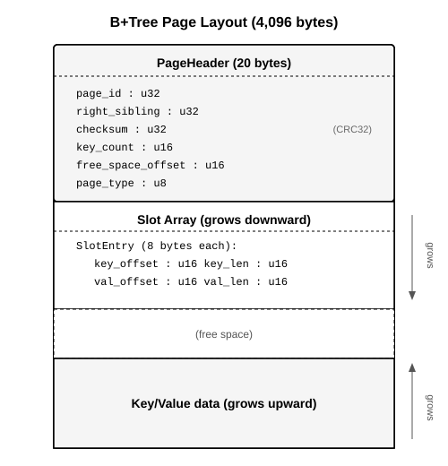
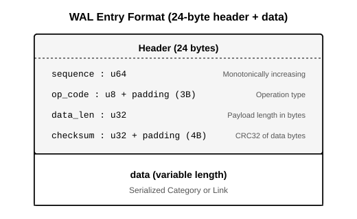
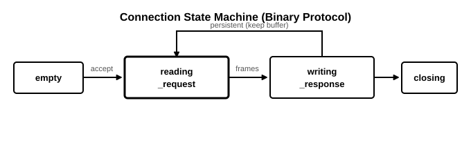
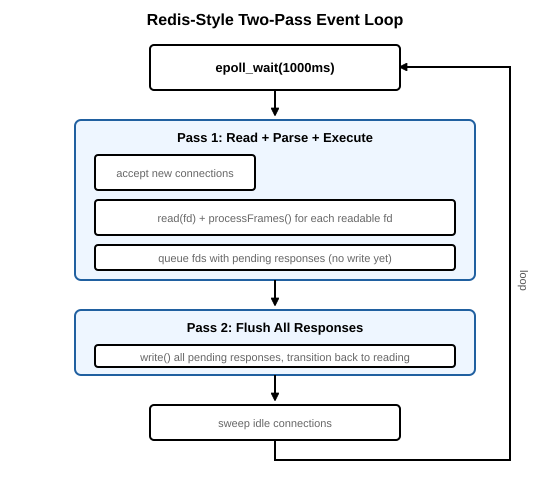
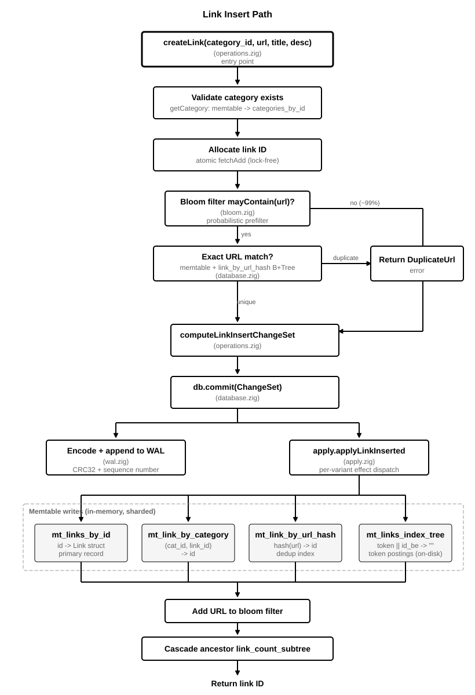
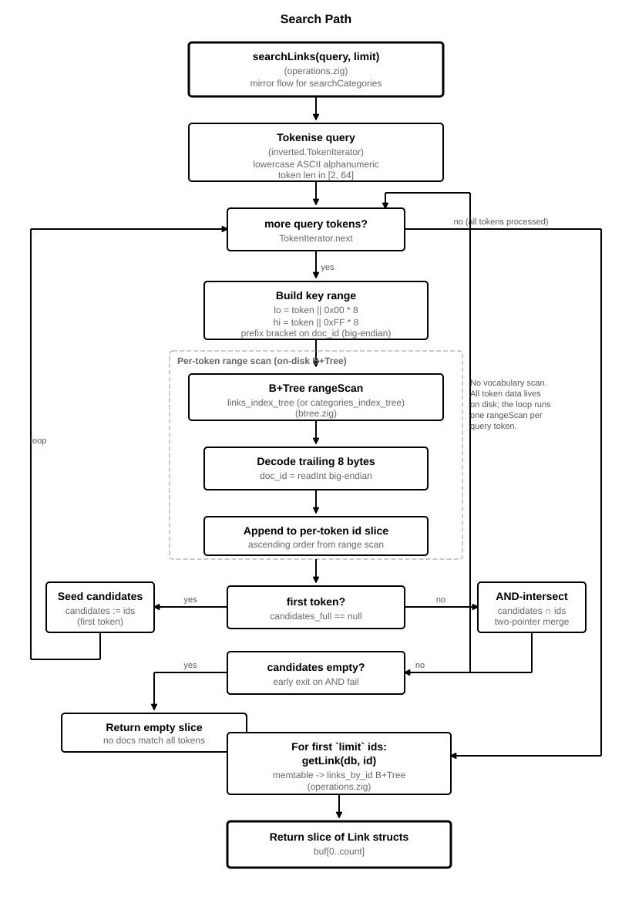

# Architecture notes

These notes go deeper than the overview in the [README](../README.md#architecture). They cover the B+Tree and page
cache, the write-ahead log, slug-path resolution and repair, the connection and event loop, the insert path and
search, followed by the design decisions behind them. The storage engine is the separate library
[zigstore](https://github.com/poly-glot/zigstore); where a section says "in zigstore", the code is there and not in
this repository. The wire format is in the [protocol reference](protocol.md).

## B+Tree Index Engine

The B+Tree implementation (`btree/` in zigstore) is the core of the storage engine.

**Page layout** (16,384 bytes per page):

<p align="center">
  
</p>

Key properties:

- **Leaf nodes** store key-value pairs directly; linked via `right_sibling` for efficient range scans
- **Internal nodes** store keys with child page pointers for tree navigation
- **Max tree depth**: 32 levels
- **Keys**: variable-length byte slices, compared lexicographically
- **Composite keys** use big-endian encoding to preserve sort order (e.g., `parent_id ++ child_id`)
- **Page types**: leaf (0), internal (1), overflow (2), free (3)

## Page Cache (Buffer Pool)

The page cache (`page_cache.zig` in zigstore) keeps frequently accessed pages in memory:

- **Configurable size**: default 256 MB = 16,384 pages
- **Eviction policy**: LRU per shard with pin counting; pinned pages cannot be evicted
- **No-steal dirty tracking**: pages fetched for mutation are marked dirty and never evicted; they reach `store.dat`
  only through a checkpoint (journal, then in place), and a pressure valve checkpoints early once half the cache is dirty
- **Thread-safe**: 64 shards keyed by page ID, each behind its own `std.Thread.Mutex`
- **Atomic stats**: `hit_count` and `miss_count` use `std.atomic.Value` for lock-free reads

## Write-Ahead Log

The WAL (`wal.zig` in zigstore) provides crash recovery with group commit batching.

**Entry format** (24-byte header + variable-length data):

<p align="center">
  
</p>

```
[u64 sequence][u8 op_code][3B pad][u32 data_len][u32 crc32(data)][4B pad][data...]
```

dmozdb writes a single WAL op code, `100`, whose data is an encoded `ChangeSet`. The ChangeSet carries its own effect
tags (`link_inserted`, `link_deleted`, `link_text_updated`, `link_recategorized`, `category_inserted`,
`category_deleted`, `category_text_updated`, `category_renamed`, `category_moved`, `slug_path_repair_chunk`,
`slug_path_repair_complete`), so replay and live apply share one decoder and one `apply()`.

**Group commit**: the flusher thread wakes when the batch reaches `DMOZDB_WAL_BATCH_SIZE` (default 256) or after a
fixed 2 ms, writes every pending entry and issues one `fdatasync`. A request waits once, after all its writes, for the
highest sequence it wrote to pass that fsync, so the items of a batch frame and the writes of concurrent connections
share fsyncs. If an fsync fails, `fsync_failed` is set and stays set: every later commit is refused
with `error.WalFlushFailed` before it is appended, and `Directory.commit` aborts the process on it, because the entry
whose fsync failed is already applied in memory and only a restart makes what is served match what is durable.

**Recovery scan**: on open the WAL is scanned for the last valid record. A torn tail of at most one group-commit batch
is trimmed; valid records more than one batch beyond a corrupt record mean the damage is not a torn write, so the store
refuses to start (`error.WalCorrupt`) instead of silently discarding them.

## Slug Path Resolution

Category slugs form a hierarchical namespace (e.g., `computers/programming/zig`). Path lookups are served by two B+Trees populated atomically on every category mutation:

- **`categories_by_slug_path`** maps the full hierarchical path → cat_id. Used by `browse_path` and `resolve_slug_path`. Maintained inline by every category create/delete/rename/move.
- **`categories_by_slug_only`** maps a leaf slug → the shallowest cat_id holding that slug. Used as a single-segment fallback for short URLs.

A `resolve_slug_path` lookup is one B+Tree search in steady state. During the post-rename/move repair window (when `slug_path_repair_queue.entry_count > 0`), the resolver also walks the resolved cat's parent chain to confirm the canonical path matches the queried path; see [Slug-Path Repair Queue](#slug-path-repair-queue).

## Slug-Path Repair Queue

A **rename or move of a non-leaf category** invalidates every descendant's stored full slug path. For small subtrees the rewrite is cheap and happens atomically inside the rename's ChangeSet apply. For large subtrees (e.g. `Top/Regional` with 10⁵ descendants) the in-line rewrite would hold the apply mutex for seconds; the database instead defers the cleanup to a dedicated background worker.

**Threshold.** `DMOZDB_RENAME_INLINE_THRESHOLD` (default 5000) selects between the two paths. The compute step walks descendants depth-first, capped at `threshold + 1`, to detect breach without scanning the entire subtree.

**Below threshold (atomic).** The rename/move ChangeSet carries a list of `(old_path, new_path, cat_id)` swaps. `apply_category_renamed` / `apply_category_moved` delete-then-insert each pair on `categories_by_slug_path` in the same `db.commit()` as the primary record update. No queue write.

**Above threshold (queued).** The ChangeSet carries an `EnqueueOnApply` payload with a fresh `seq` from the `next_repair_seq` counter. Apply writes a `RepairTask` record (2,080 bytes: `cat_id`, op, timestamp, old slug prefix) to `slug_path_repair_queue` keyed by big-endian seq. The renamed cat itself is updated atomically; its descendants stay stale until the worker drains them.

**Repair worker (`src/repair/repair_worker.zig`).** Started by `Directory.start_background_threads()`. Each tick (`DMOZDB_REPAIR_WORKER_INTERVAL_MS`, default 1 s) it pops the min-key task, walks the cat's descendants via `cat_by_parent`, and emits chunked `slug_path_repair_chunk` ChangeSets (`DMOZDB_REPAIR_WORKER_CHUNK_SIZE` descendants visited per chunk, default 1000; every writer waits for the chunk in progress, about 45 ms per 1000 visits on the 92k store) until the walk completes. Each chunk is its own `db.commit()`, so progress is WAL-durable. After the final chunk, a `slug_path_repair_complete` removes the queue entry. Crash mid-walk is idempotent: the queue entry survives until the final commit, and chunk emission checks the old path still exists before scheduling a swap.

**Read-side validation.** `resolve_slug_path` short-circuits when `slug_path_repair_queue.entry_count == 0`, so there is no extra cost in steady state. When the queue is non-empty, every resolve walks the resolved cat's parent chain and confirms its current canonical path matches the query; mismatch returns `not_found`. Stale paths are hidden from clients during the window, never returning a wrong cat_id.

**Operator visibility.** Op 18 `index_health` response includes the queue depth, worker last-tick timestamp, total tasks processed, and total chunks processed. The worker logs at `info` per task and at `warn` when queue depth crosses 100 / 1 000 / 10 000.

## Connection State Machine

Each of the 4,096 connection slots (`connection.zig` in zigstore) progresses through phases:

<p align="center">
  
</p>

> Diagram source: [`diagrams/04-connection-state-machine.mmd`](../diagrams/04-connection-state-machine.mmd)

- **reading_request**: edge-triggered `EPOLLIN` drains all available data into the 64 KiB request buffer
- **writing_response**: response is flushed to the socket; on completion, transitions back to `reading_request` (persistent connections keep their buffer)
- **closing**: socket is removed from epoll and closed; the slot is reset to `empty`

Binary connections are persistent: after writing a response, the connection loops back to reading without releasing its buffer or re-arming epoll.

## Event Loop

The epoll event loop uses a two-pass design inspired by Redis:

<p align="center">
  
</p>

> Diagram source: [`diagrams/06-event-loop.mmd`](../diagrams/06-event-loop.mmd)

**Pass 1 (read)**: Process all readable events: accept connections, read data, parse and execute binary protocol frames inline. Connections with pending responses are queued but not written yet.

**Pass 2 (write)**: Flush all pending responses in one batch. Most writes complete inline (TCP send buffer is rarely full for small response frames). If `write()` returns `WouldBlock`, the connection is armed for `EPOLLOUT` to retry later.

This eliminates the per-request `epoll_ctl MOD` syscall overhead that occurs when alternating between read and write arming on each request.

## Link Insert Path

Creating a link is one synchronous call on the reactor thread that ends with a durable WAL entry.

<p align="center">
  
</p>

> Diagram source: [`diagrams/07-link-insert-path.mmd`](../diagrams/07-link-insert-path.mmd)

The steps in detail:

**1. Validate.** Field lengths are checked against the limits in `src/operations/operations_shared.zig` (URL 64, title 128, description 256 bytes; `FieldTooLong` otherwise), then the target category must exist. `get_category` checks the memtable first, then falls through to the `categories_by_id` B+Tree. A missing category returns `CategoryNotFound` without side effects.

**2. Duplicate URL check.** Three tiers, cheapest first. The bloom filter (lock-free atomic bit reads) rejects most unique URLs immediately. On a possible hit, the `link_by_url_hash` memtable is consulted, then the B+Tree. A hash match is confirmed by comparing the stored link's URL bytes, so only a true byte-level match returns `DuplicateUrl`.

**3. Allocate link ID.** `next_link_id.fetchAdd(1)`. This happens after the duplicate check, so a rejected duplicate does not burn an ID.

**4. Compute the ChangeSet.** `compute_link_insert_change_set` produces a `link_inserted` effect carrying the `Link` record, its tokens (title, URL, description through `inverted_index.TokenIterator`: lowercase ASCII alphanumeric runs of length 2–64) and the ancestor count updates.

**5. Commit.** `db.commit(cs)` appends the encoded ChangeSet to the WAL, then applies it under the apply mutex:
`link_by_category`, `link_by_url_hash`, `link_by_submitter` (when `submitter_id != 0`) and `links_by_id` receive memtable puts; the token rows `(token ‖ link_id_be) → ""` go straight into `links_index_tree`; every ancestor's `link_count_subtree` (and the direct category's `link_count`) is rewritten through the `categories_by_id` memtable; the URL is added to the bloom filter; the status counter is bumped; the subtree cache is invalidated.

**6. Wait for durability.** The handler writes `[ok][none][link_id]` into the response, and `Directory.dispatch` holds the response until the WAL flusher has `fdatasync`ed the request's last entry. A frame of many items therefore pays a few fsyncs, not one per item, and write latency is bounded below by one group-commit cycle.

## Search

Full-text search is served by two on-disk B+Trees: `categories_index_tree` and `links_index_tree`. Each tree's keys are `(token bytes ‖ document_id_be)` with empty values; a range scan over `(token ‖ 0) .. (token ‖ MAX)` returns every document id whose text contains the token. There is no in-memory inverted index.

<p align="center">
  
</p>

> Diagram source: [`diagrams/08-search-path.mmd`](../diagrams/08-search-path.mmd)

**Tokenisation.** The query string runs through the same `inverted_index.TokenIterator` used at write time: lowercase ASCII alphanumeric runs of length [2, 64]. Identical tokenisation at write and search guarantees byte-identical matches.

**Per-token posting list.** For each query token the search emits one B+Tree range scan, accumulating document IDs. Posting lists are sorted by ID, so results stream in order without an explicit sort.

**Modes.** The mode byte picks one of three strategies:

- `all_terms` (the default, used by the admin screens) intersects the posting lists, so only documents containing every token match, returned in ID order.
- `ranked` scores every document containing any token by the sum of its tokens' IDF, `ln(1 + (N − df + 0.5)/(df + 0.5))`, highest first, ties on ascending ID. A token whose posting list passes 20,000 entries contributes nothing, which bounds the cost of tokens like `www`.
- `hybrid` runs `ranked` for the top 200 keyword candidates and a flat int8 dot-product scan over the in-memory vector matrix for the top 200 nearest links, then fuses the two lists with reciprocal rank fusion (k = 60). If the query's model differs from the stored one, or the matrix is still loading after boot, it answers from keywords alone and clears `vector_used`.

**Vectors.** The web tier embeds text with `bge-small-en-v1.5` (int8 ONNX, CLS pooling, 384 dimensions) and writes link vectors with `put_link_vectors`; dmozdb never runs a model. A title or description edit, or a delete, removes the link's vector in the same apply, and a write carrying a stale text fingerprint is refused, so a stored vector always matches the link's current text. The matrix is rebuilt from `link_vectors` by a background thread after the port opens.

**Graph facts.** `query_links` answers filter, count and group questions that ranking cannot ("how many sites
are hosted on tripod.com"). An in-memory facts index, loaded after the port opens and kept in step by the
apply path, holds per link its host, registrable domain, site and ccTLD country, and per category its parent,
the country it is named for, its top-level branch and its place in a depth-first order, so a subtree test is
two integer comparisons. A site is the unit a person publishes: a subdomain on hosting platforms such as
tripod or blogspot, the leading path segments on path platforms (`members.tripod.com/{name}`,
`angelfire.com/{area}/{name}`, `groups.yahoo.com/group/{name}`), a `~user` path on any host, and otherwise
the registrable domain. A category named for a country ties its subtree to it, outermost name first
(`United_States > Georgia` is the US), except under alphabet buckets and breed or food categories.

**Entity facts.** The web tier reads each link's title and description for the places, religions, people and
organisations it names (ONNX `bert-base-NER` spans, a gazetteer built from GeoNames, a religion lexicon) and writes
them with `put_link_entities`; as with vectors, dmozdb never runs a model, and a title or description change or a
delete drops the record. A named place is a third country edge beside the ccTLD and the category, so `query_links`
can ask for links tied to Pakistan by any edge, about Islam, or naming Jamia Farooqia.

**Asking in words.** The search page reads a query for the things `query_links` can filter on and targets them,
so "show me links in art category under Pakistan for islam" lists links in Arts, tied to Pakistan and about Islam.
It finds domains by shape, countries by name, alias or nationality, and religions by name, using the extractor's
own lexicons. `match_names` finds categories and people or organisations. A category is targeted when the
sentence points at it ("in jazz", "the arts category") or its name has a word that is not in the corpus's
common lowercase words ("pink floyd"); a person or organisation needs two or more words, one of them uncommon,
so "web design" stays words. Each target shows as a chip that removes it, the words left over must appear in a
link, and when nothing matches the page offers the count with each target dropped. `site:`, `country:`, `in:`,
`religion:` and `name:` state a target outright and are what the chips link to.

**Materialisation.** The first `limit` (at most 50) IDs are hydrated via `get_link` / `get_category` (memtable → primary B+Tree). Documents that no longer exist (deleted between indexing and search) are silently skipped. Each link row carries a `match_field` byte telling the client whether the title, URL or description matched, or that only the vector half found it.

**What the search does not do.** No term frequency or document length (IDF over binary postings measured within noise of BM25 on this corpus; `eval/graphrag/hybrid_design_check.py` repeats the comparison), no field boosting, no phrase queries or fuzzy matching. Non-ASCII characters are not lowercased; a search for "blüm" will not match a document containing "Blüm" because the tokeniser only handles ASCII case folding.

---

## Design decisions

The following decisions shape the architecture and implementation of dmozdb. Each was made deliberately to favour
simplicity, predictability and raw throughput over generality.

### One dependency: zigstore

The engine is the public library zigstore, pinned by URL and hash in `build.zig.zon`. Everything else compiles against
the Zig 0.16 standard library. There is no vendored C code and no build system beyond `build.zig`. Upgrading the engine
is a one-line change to the pinned tag; schema and operations stay here.

### Binary protocol only

dmozdb exposes a single binary TCP protocol. There is no HTTP layer, no JSON serialisation and no REST surface. Every
request is an 8-byte header followed by a typed payload; every response is a 10-byte header followed by a typed payload.
This eliminates the parsing overhead of text protocols, avoids allocation for header maps and enables pipelining
without framing ambiguity. The web frontend (Deno Fresh) translates between the user-facing HTTP surface and the binary
protocol over a persistent TCP connection, using the generated client in `web/lib/dmoz-protocol.gen.ts`.

Adding a new operation requires one enum variant, one switch arm and one handler function. The `BatchCreateHandlerType`
uses Zig comptime to generate the field parsing loop from a declarative spec, ensuring that the wire format and the
struct definition cannot drift apart.

### Extern structs for on disk types

`Category` (1,288 bytes), `Link` (1,888 bytes) and `RepairTask` (2,080 bytes) are declared as `extern struct` with
explicit padding fields. This guarantees a deterministic, platform-independent memory layout that can be written to
disk and read back without serialisation. The page cache stores these structs as raw byte slices and the binary
protocol copies them directly into response buffers. Comptime assertions enforce the expected sizes at build time; if a
field is added or reordered, the build fails immediately.

The tradeoff is wasted space. A `FixedString(256)` always occupies 258 bytes (256 data + 2 byte length) regardless of
the actual string length. This is acceptable for a directory application where record counts are in the tens of
thousands rather than billions, and the benefit of zero-copy reads and writes dominates the cost of padding.

### Big endian composite keys

B+Tree keys are compared lexicographically as byte slices. For composite keys such as `(parent_id, child_id)`, we encode
each component in big endian so that the natural byte ordering matches the logical sort order. A range scan for "all
children of parent 5" becomes a prefix scan on `\x00\x00\x00\x00\x00\x00\x00\x05` without any custom comparator. This
simplifies the B+Tree implementation considerably because it can treat all keys as opaque `[]const u8` slices.

### WAL before mutation, ack after fsync

Every write appends its ChangeSet to the WAL before touching a memtable or B+Tree. On crash recovery the whole log is
replayed from sequence 0 through the same `apply()` that served the live request, so recovery is pure replay with no
business logic of its own.

Group commit amortises `fdatasync` across up to `DMOZDB_WAL_BATCH_SIZE` entries, and a request waits once for its
last entry rather than once per entry, outside `write_mutex`, so other writers keep appending while it waits. A client that receives `ok` has a durable write. The cost is write latency bounded
below by one flusher cycle; the benefit is that there is no window in which an acknowledged write can be lost.

### Inline processing on the epoll thread

Binary protocol operations execute directly on the epoll reactor thread. There is no thread pool, no task queue and no
completion callback. This eliminates context switch overhead, simplifies memory ownership (no cross-thread buffer
handoff) and avoids the head-of-line blocking that occurs when a slow operation holds a thread pool slot.

The tradeoff is that a slow operation (a large range scan that misses the cache, or a write waiting on fsync) blocks
that reactor for its duration. Reads are mitigated by the page cache: hot data stays in memory and the working set of a
directory application is small relative to available RAM. Writes pay the group-commit latency by design.

### Edge triggered epoll with two pass event loop

The event loop follows the Redis model. Each iteration calls `epoll_wait` once, then processes all returned events in
two passes. The first pass handles all readable events: accepting connections, reading request data and executing
protocol frames. The second pass flushes all pending response buffers. This batches write syscalls and eliminates the
need to toggle between `EPOLLIN` and `EPOLLOUT` on every request, saving one `epoll_ctl` syscall per round trip.

Edge triggered mode (`EPOLLET`) requires the application to drain all available data on each wake. The read loop
continues calling `read()` until it returns `EAGAIN`. This is more complex than level triggered mode but avoids
redundant wake ups when data arrives faster than the application can process it.

### Sharded memtable with background drain

Writes to the six primary and secondary-key indexes go first to a 32-shard in-memory memtable, then drain to the
underlying B+Tree in the background every 5 ms. Sharding reduces lock contention because each shard has its own mutex.

The memtable acts as a write buffer but not as a read cache. Point lookups check the memtable first and fall through to
the B+Tree on miss, so reads always see the latest write. Handlers that need a complete range (`browse_path`,
`list_subtree_links`, `stats`) drain the relevant memtable on entry.

### Lock free bloom filter for duplicate detection

URL deduplication uses a bloom filter with seven probes derived from two Wyhash seeds. The filter provides lock-free
reads via atomic bit operations, so duplicate checks on the hot path do not contend with writers. False positives are
acceptable because a bloom filter hit triggers a secondary lookup in the `link_by_url_hash` index, which is
authoritative. The filter is sized at startup to the larger of 1,000,000 and twice the stored link count and seeded from
`links_by_id` by a background thread after the port opens; until `url_bloom_ready` is set every duplicate check goes to
the index.

### Hybrid in-line / queued slug-path repair

Renaming or moving a non-leaf category invalidates every descendant's slug-path entry. The naive append-only rebuild
leaves stale entries as orphans; a strict in-line rewrite holds the apply mutex for seconds on a 10⁵-descendant subtree.

dmozdb takes a hybrid path: subtrees up to `DMOZDB_RENAME_INLINE_THRESHOLD` (default 5000) descendants get rewritten
atomically inside the rename's ChangeSet; larger subtrees enqueue a single durable repair task into the
`slug_path_repair_queue` B+Tree, drained by a dedicated background worker (`src/repair/repair_worker.zig`). A read-side
validation gate hides stale entries during the repair window. The whole pipeline is WAL-covered, so a crash mid-walk
is idempotent on recover.

The trade-off is a brief window where descendants of a giant-subtree rename appear `not_found` via their old slug
paths until the worker repairs them. Choosing strict-in-the-window over best-effort means clients never resolve stale
paths to live IDs, at the cost of an O(depth) extra read per resolve while the queue is non-empty.

### Single reactor per thread, no shared mutable state between reactors

Each reactor thread owns its own epoll instance, connection table and buffer pool. The kernel distributes incoming
connections across reactors via `SO_REUSEPORT`. Reactors share the database (the page cache, memtables and B+Trees are
internally synchronised, and commits serialise on the apply mutex) but never share connection state. This eliminates
inter-reactor locking and makes the connection handling path entirely single threaded within each reactor.

### Comptime assertions as a safety net

Struct sizes, page layout offsets and protocol constants are validated at compile time using `comptime` blocks. If a
developer adds a field to `Category` without updating the padding, the build fails with a clear error message. This
catches a class of subtle bugs (layout drift, alignment violations, protocol version mismatch) that would otherwise
surface as silent data corruption at runtime.

### Page size and cache configuration

Pages are 16 KB (`page.PAGE_SIZE` in zigstore). The default page cache is 256 MB, which holds 16,384 pages. For a
directory with 100,000 links, the entire dataset fits comfortably in cache. The cache uses LRU eviction with pin
counting; pages held by an active B+Tree traversal cannot be evicted.

The page cache is split into 64 shards by page ID to reduce lock contention. Each shard has its own LRU list. Dirty
pages are written back on snapshot, on shutdown, or when a shard evicts a dirty page to make room for a new one.

### Error handling philosophy

Errors on the request path (malformed protocol frames, missing records, constraint violations) are reported to the
client as `status` / `sub_status` in the response header. The server continues processing subsequent frames on the same
connection.

Errors on the durability path are not retried. A failed WAL `fdatasync` sets a sticky `fsync_failed` flag and every
later commit fails with `error.WalFlushFailed` (reported as `status=err`) until the process restarts. A failed memtable
drain panics, because continuing would leave the B+Trees behind the WAL with no way to tell.

### Protected mode

The binary protocol has no application-level authentication, no TLS and no challenge-response handshake. This is a
deliberate design choice. Adding a pre-shared key without TLS provides no meaningful security because the key travels in
plaintext and can be captured by a passive observer on the network path.

The security model follows the same approach as Redis (since 3.2) and TigerBeetle: network isolation is the primary
control, enforced at the application layer as a safety net. The server binds to `127.0.0.1` by default. If the operator
sets `DMOZDB_BIND=0.0.0.0` without configuring `DMOZDB_TRUSTED`, the server enters protected mode. In protected mode it
accepts connections on the wildcard address but rejects any connection from a non-loopback IP at accept time, before
allocating a buffer or processing any frames. The check uses `getpeername` on the accepted socket and compares the
source IPv4 address against the configured trusted addresses and CIDR ranges. Loopback addresses (`127.0.0.0/8`) are
always permitted.

This provides three levels of defence:

1. **Default bind** (loopback only). The listen socket is never reachable from the network. This is the correct
   configuration when the client runs on the same host or pod.
2. **Explicit trusted IPs and CIDRs**. The operator sets `DMOZDB_TRUSTED=10.0.0.5,10.244.0.0/16` to allow specific
   addresses or ranges (the Kubernetes manifests pass the pod and node CIDRs). All other non-loopback sources are
   rejected at accept time with a log warning.
3. **Protected mode fallback**. If the operator binds to `0.0.0.0` but forgets to configure trusted IPs, the server logs
   a warning at startup and rejects non-loopback connections. This prevents accidental exposure, which is the failure
   mode that led to the Redis and MongoDB incidents of 2016 and 2017 respectively.

The tradeoff is that this does not protect against a compromised host on the trusted network. For deployments where the
network path crosses the public internet, the operator should add a WireGuard tunnel or equivalent encrypted overlay and
restrict `DMOZDB_TRUSTED` to the tunnel peer address.

### What dmozdb is not

dmozdb is not a general-purpose database. It has no query language, no multi-record transactions and no secondary index
creation at runtime. zigstore ships a replication module, but dmozdb does not wire it: there is one writer process. It is
purpose-built for the DMOZ directory use case: a modest number of hierarchically organised categories and links,
read-heavy workloads with occasional writes.
