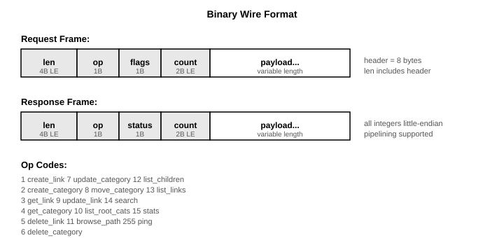

# Binary protocol reference

dmozdb speaks one protocol: binary frames over TCP, with no HTTP layer. This page lists every op, status code and
payload layout. The web tier calls it through the generated client in `web/lib/dmoz-protocol.gen.ts`, and the
rules for changing it are in [`.claude/rules/protocol.md`](../.claude/rules/protocol.md). The reasons for the design
are under [Design decisions](architecture.md#design-decisions). The [README](../README.md) has the quickstart and the
configuration table.

## Wire Format

<p align="center">
  
</p>

> Diagram source: [`diagrams/05-binary-wire-format.mmd`](../diagrams/05-binary-wire-format.mmd)

Requests carry an 8-byte header, responses a 10-byte header. All integers are little-endian. `len` includes the header.
Multiple frames can be pipelined on the same persistent TCP connection.

```
Request:  [u32 len][u8 op][u8 reserved][u16 count][payload...]
Response: [u32 len][u8 op][u8 status][u8 sub_status][u8 pad][u16 count][payload...]
```

`count` is the number of items in a batch request, and the number of rows in a list response.

## Op Codes

| Code   | Op                        | Batch   | Description                                                              |
|--------|---------------------------|---------|--------------------------------------------------------------------------|
| 1      | `create_link`             | yes     | Create links (count items)                                               |
| 2      | `create_category`         | yes     | Create categories (count items)                                          |
| 3      | `get_link`                | no      | Get link by ID                                                           |
| 4      | `get_category`            | no      | Get category by ID                                                       |
| 5      | `delete_link`             | no      | Delete link by ID                                                        |
| 6      | `delete_category`         | no      | Delete category by ID                                                    |
| 7      | `update_category`         | no      | Update category fields (bitmask)                                         |
| 8      | `move_category`           | no      | Move category to new parent                                              |
| 9      | `update_link`             | no      | Update link fields (bitmask)                                             |
| 10     | `list_root_categories`    | no      | List root categories with pagination                                     |
| 11     | `browse_path`             | no      | Resolve a slug path: category, ancestors, children, subtree link count   |
| 12     | `list_children`           | no      | List child categories with pagination                                    |
| 13     | `list_links`              | no      | List links in a category; optional status filter and cursor              |
| 14     | `search`                  | no      | Full-text search categories and links                                    |
| 15     | `stats`                   | no      | Database statistics                                                      |
| 16     | `list_all_links`          | no      | List links across all categories; optional status filter and cursor      |
| 17     | `list_subtree_links`      | no      | List links in a subtree (transitive over all descendants) with pagination |
| 18     | `index_health`            | no      | Verifier snapshot + slug-path repair queue depth + worker counters        |
| 19     | `run_verifier`            | no      | Run the verifier inline, then return the `index_health` frame            |
| 20     | `rebuild_index`           | no      | Rebuild the derived indexes if the cache holds them, drain the repair queue |
| 22     | `snapshot`                | no      | Checkpoint (journaled page + header flush, WAL truncate), write `snapshot.meta` |
| 23     | `op_latency_stats`        | no      | Per-op latency percentiles since boot                                    |
| 24     | `bulk_import`             | yes     | Insert up to 50,000 links from one frame (importer path)                 |
| 25     | `create_submission`       | no      | Create a link with status `pending` and a submitter ID                   |
| 26     | `update_link_status`      | no      | Set one link's status                                                    |
| 27     | `list_links_by_submitter` | no      | List a submitter's links; optional status filter and cursor              |
| 28     | `move_link`               | no      | Move a link to another category                                          |
| 29     | `get_categories_by_ids`   | no      | Fetch up to 200 categories by ID                                         |
| 30     | `breadcrumbs_by_ids`      | no      | Ancestor chains (id, name, slug) for up to 200 categories                |
| 34     | `bulk_update_link_status` | no      | Set status on up to 200 links, per-item result codes                     |
| 35     | `bulk_delete_links`       | no      | Delete up to 200 links, per-item result codes                            |
| 36     | `counts_by_status`        | no      | Link counts per status                                                   |
| 37     | `put_link_vectors`        | no      | Store up to 32 link embeddings, per-item result codes                    |
| 38     | `query_links`             | no      | Count, filter and group links by domain, site, country, category, words  |
| 39     | `put_link_entities`       | no      | Store up to 64 link entity records, per-item result codes                |
| 40     | `match_names`             | no      | Per phrase: the largest category with that name, and whether links name it |
| 41     | `put_category_vectors`    | no      | Store up to 32 category embeddings, per-item result codes                |
| 42     | `neighbours`              | no      | Sites, categories and entities near a site, category or entity          |
| 255    | `ping`                    | no      | Ping/pong                                                                |

Codes 21 and 31–33 are unassigned.

## Status Codes

| Code   | Status               | Meaning                              |
|--------|----------------------|--------------------------------------|
| 0      | `ok`                 | Success                              |
| 1      | `not_found`          | Resource not found                   |
| 2      | `duplicate`          | Duplicate URL                        |
| 3      | `invalid`            | Invalid request payload              |
| 4      | `err`                | Internal error                       |
| 5      | `category_not_found` | Category does not exist              |
| 6      | `has_children`       | Cannot delete: category has children |
| 7      | `circular`           | Circular hierarchy detected          |

## Sub-Status Codes

`sub_status` refines `status`; it is `none` unless listed here.

| Code   | Sub-status            | Paired with          | Meaning                                              |
|--------|-----------------------|----------------------|------------------------------------------------------|
| 0      | `none`                | any                  | No refinement                                        |
| 1      | `field_too_long`      | `invalid`            | A string exceeds its `FixedString` capacity, or a `bulk_import` frame exceeds its caps |
| 2      | `invalid_slug`        | `invalid`            | Slug fails validation                                |
| 3      | `buffer_too_small`    | `invalid`            | Response would not fit the connection buffer         |
| 4      | `path_too_deep`       | `invalid`            | Category depth limit exceeded                        |
| 5      | `unsupported_order`   | `invalid`            | `list_subtree_links` order code other than 0, or an unknown link status byte |
| 6      | `parent_not_found`    | `category_not_found` | Parent category missing on create/move               |
| 7      | `duplicate_url`       | `duplicate`          | URL already stored                                   |
| 8      | `offset_too_large`    | `invalid`            | A list offset above 5000 (ops 13, 16, 17, 27), or one a filtered page's row budget cannot reach |
| 9      | `already_in_progress` | `err`                | A snapshot is already running                        |
| 10     | `duplicate_slug`      | `duplicate`          | A sibling category already has that slug (create, rename, or move) |
| 11     | `embedding_model_mismatch` | `invalid`       | `put_link_vectors` model differs from the one the store already holds |
| 12     | `too_broad`           | `invalid`            | A search or `query_links` question matches more than one request may read; it is refused, never answered in part |

## CRUD Operations

**Create link (op=1, batch)**
```
Request payload per item:
  [u64 category_id][u16 url_len][url][u16 title_len][title][u16 desc_len][desc]

Response per item (count = items written):
  [u8 status][u8 sub_status][u64 link_id]
```

**Create category (op=2, batch)**: same layout with `[u64 parent_id][name][slug][desc]`.

**Get link/category (op=3/4)**
```
Request:  [u64 id]
Response: [full extern struct bytes]   (Link=1888B, Category=1288B)
```

**Get categories by IDs (op=29)**
```
Request:  [u16 n (<= 200)][n x u64 id]
Response: header (count=found) + [found x Category struct bytes]   (missing IDs are skipped)
```

**Delete link/category (op=5/6)**
```
Request:  [u64 id]
Response: header only (status in header)
```

## Query Operations

**List root categories (op=10)**
```
Request:  [u32 offset][u32 limit]
Response: header (count=N) + [N x Category struct bytes]
```

**List children (op=12)**
```
Request:  [u64 parent_id][u32 offset][u32 limit]
Response: header (count=N) + [N x Category struct bytes]
```

**List links (op=13)**, **list all links (op=16)**, **list links by submitter (op=27)**
```
Request (op=13): [u64 category_id][u32 offset][u32 limit][extras]
Request (op=16): [u32 offset][u32 limit][extras]
Request (op=27): [u64 submitter_id][u32 offset][u32 limit][extras]

extras, optional trailing bytes:
  (none)                      no status filter, offset pagination
  [u8 status]                 filter by status 0=pending 1=approved 2=rejected
  [u8 status][u64 after_id]   status 0xFF = no filter; after_id > 0 = cursor pagination

Response: header (count=N) + [N x Link struct bytes][u64 next_after_id]
```

`limit` is capped by a 128 KiB row budget: 69 links per page (100 for category lists). `offset` is at most 5000.
`next_after_id` is 0 when there is no further page. A page reads at most 50,000 index rows, so a filter that matches
few rows (the moderation queue's pending links) can end a page early, even empty, with a non-zero `next_after_id`:
page on from it. The web client (`web/lib/dmoz-client.ts`) follows such empty pages itself, up to 64 requests.

**List subtree links (op=17)**
```
Request:  [u64 category_id][u8 order_code (must be 0)][u32 offset (<= 5000)][u32 limit][extras as above]
Response: [u32 written][written x Link struct bytes][u64 total][u64 next_after_id]   (header count=0)
```

`limit` 0 means 50; the maximum is 100. An unknown `category_id` answers `not_found`. `total` is the subtree's exact
link count for the status filter (approved, pending or rejected), read from the category record, or over every status
when the request has no status. A filtered or cursor page reads at most 10,000 rows and can end early, even empty, with a
non-zero `next_after_id`, as the link lists do.

**Browse path (op=11)**
```
Request:  [u16 path_len][path]   e.g. "top/computers/programming"
Response: [Category bytes][u16 ancestor_count][ancestors...][u16 child_count][children (<= 100)...][u64 link_count_subtree]
```

Ancestors are ordered root-first. `link_count_subtree` is the transitive link count of the subtree.

**Breadcrumbs by IDs (op=30)**
```
Request:  [u16 n (<= 200)][n x u64 id]
Response: header (count=n) + per id: [u16 crumb_count][crumb_count x ([u64 id][66B name][130B slug])]
```

Each crumb list runs root-first and ends with the category itself; an unknown ID yields `crumb_count=0`. A stored
row on a chain that cannot be read fails the whole request with `err`, as op 29 does.

**Search (op=14)**
```
Request:  [u16 query_len (2..1024)][query][u32 limit][optional u8 scope: 0=both 1=links_only 2=categories_only]
          [optional u8 mode: 0=all_terms 1=ranked 2=hybrid][hybrid only: u64 model][384 x f32 LE query embedding]
          [optional u8 cap_per_site: 0 or 1, ranked and hybrid only]
Response: [u16 cat_count][categories...][u16 link_count][link_count x ([Link bytes][u8 match_field]
          [cap_per_site = 1 only: u16 len][site][u16 more])][hybrid only: u8 vector_used]
```

`limit` is capped at 50 per kind. A query over 1024 bytes is `invalid`; only its first 32 distinct words are read.
An `all_terms` query is `too_broad` when its page cannot be filled from 20,000 postings of its first word with every
word over 20,000 links, or when checking its common words takes more than 20,000 lookups. A failure while searching
answers its error status, never an empty `ok`. `match_field` is 0=title, 1=url, 2=description, 3=semantic (found by
the vector half only). An absent mode byte means `all_terms`. `vector_used` is 0 when the server answered from
keywords alone.
`cap_per_site` = 1 keeps at most two links from one site, with sites decided as for `query_links`, so
`members.tripod.com/~a` and `members.tripod.com/~b` are two sites. The last row kept for a site gives in `more` how
many of its links the cap passed over before the page filled.

**Put link vectors (op=37)**
```
Request:  [u64 model][u16 count (1..32)][count x ([u64 link_id][u64 text_fingerprint][384 x f32 LE])]
Response: [u16 ok][u16 err][(ok + err) x ([u64 link_id][u8 code])]
```

`text_fingerprint` is FNV-1a 64 over `title ++ 0x00 ++ description`. Codes: 0=ok, 1=not_found, 2=stale_text (the
link's text changed since it was embedded), 3=invalid_vector (non-finite or zero). The server L2-normalises and
quantises to int8. A `model` of 0, or one different from the stored model, is refused for the whole frame.

**Query links (op=38)**
```
Request:  [u64 category_id (0 = all)][u16 len][domain suffix][u16 len][ISO country or empty]
          [u64 options][u16 len][words][u16 len][entity name or empty][u64 after_id]
Options:  bits 0-3 country edges (1 ccTLD, 2 category, 4 entity; 0 all), bit 4 hosted sites only,
          bit 5 all words, bits 6-9 group by (0 none, 1 domain, 2 site, 3 host, 4 branch, 5 country,
          6 religion, 7 person, 8 organisation), bits 10-17 status (0xFF any), bits 18-25 group limit (<= 50),
          bits 26-33 page limit (<= 50), bits 34-49 religions (one bit each; 0 any),
          bit 50 subdomain sites only (a whole host on a hosting platform, not a path site)
Response: [u8 ready][u64 links][u64 sites][u64 hosts][u64 domains]
          [u16 group_count][group_count x ([u16 len][label][u64 branch_id][u64 links][u64 sites])]
          [u16 link_count][link_count x ([Link bytes][u16 len][site][2 ccTLD country][2 category country]
                                         [u16 religions][u8 n][n x 2 entity country])]
          [u64 next_after_id]
```

`ready` is 0 until the facts index has loaded after boot. A domain suffix matches whole labels, so `tripod.com`
covers every `*.tripod.com` host and never `nottripod.com`. Words use the search postings; a value with no
searchable word is `invalid`. Any word held by more than 20,000 links (with all words: every word), a question that
would visit more than 2^22 links, or a grouping with more groups than the request's scratch slab holds (2^17 in
32 MiB) is `too_broad`: the question is refused, never answered in part. Religion bits follow islam, christianity,
judaism, hinduism, buddhism, sikhism, taoism, jainism, bahai, shinto, paganism (`RELIGIONS` in the generated
client). An entity name matches a whole person or organisation name the link carries, ignoring ASCII case.

**Put link entities (op=39)**
```
Request:  [u16 count (1..64)][count x ([u64 link_id][u64 text_fingerprint][u16 len][record])]
Record:   [u8 version = 1][u16 religions][u8 n (<= 8)][n x 2 ISO country]
          [u8 n (<= 8)][n x ([u8 len (1..64)][UTF-8 person])][u8 n (<= 8)][n x ([u8 len (1..64)][UTF-8 org])]
Response: [u16 ok][u16 err][(ok + err) x ([u64 link_id][u8 code])]
```

Codes: 0=ok, 1=not_found, 2=stale_text, 3=invalid_facts (the record does not decode, or names an unknown religion
or an unassigned country). A put replaces the link's record. `text_fingerprint` is the same FNV-1a 64 as op 37.

**Match names (op=40)**
```
Request:  [u16 count (1..32)][count x ([u16 len (1..128)][phrase])]
Response: [u8 ready][u16 count][count x ([u64 category_id][u8 names_someone])]
```

A phrase matches a category whose name has the same words in any case, with a final `s` dropped from words longer
than three letters, so `art` finds `Arts` and `kids and teens` finds `Kids_and_Teens`. Of several such categories
the one with the most links in its subtree wins; `category_id` is 0 when none matches. `names_someone` is 1 when
some link's entity record names a person or organisation with exactly this name in any case. `ready` is 0, with no
rows, until the facts index has loaded.

**Put category vectors (op=41)**
```
Request:  [u64 model][u16 count (1..32)][count x ([u64 category_id][384 x f32 LE])]
Response: [u16 ok][u16 err][(ok + err) x ([u64 category_id][u8 code])]
```

Codes: 0=ok, 1=not_found, 3=invalid_vector (non-finite or zero). Code 2 is not used, because a category vector
carries no text fingerprint. A `model` of 0, or one different from the stored model, is refused for the whole frame.

**Neighbours (op=42)**
```
Request:  [u32 kind (1 site, 2 category, 3 entity)][u32 limit (1..50)][u64 category_id][u16 len][name]
Response: [u8 ready][u16 count][count x ([u16 len][label][u64 category_id][u32 shared])]
```

A site is asked for by a host suffix in `name`, folded to lower case with leading and trailing dots trimmed. An
entity is asked for by its name. A category is asked for by `category_id` alone, with `name` empty. `label` is the
site key or entity name for a site or entity neighbour, and empty for a category; `category_id` is set only for a
category neighbour. `shared` counts categories shared with a site, links shared with an entity, and for a category
1 for a namesake and 0 for a neighbour by meaning. `ready` is 0, with no rows, until the facts index has loaded.

## Update Operations

Update ops use a **bitmask byte** to indicate which fields are present.

**Update category (op=7)**
```
Request:  [u64 id][u8 bitmask][...present fields...]

Bitmask bits:
  0x01 = name    -> [u16 len][bytes]
  0x02 = slug    -> [u16 len][bytes]
  0x04 = desc    -> [u16 len][bytes]
```

**Update link (op=9)**: same pattern with `0x01=url`, `0x02=title`, `0x04=desc`.

**Move category (op=8)**
```
Request:  [u64 category_id][u64 new_parent_id]
```

**Move link (op=28)**
```
Request:  [u64 link_id][u64 new_category_id]
```

## Moderation Operations

Link status is a `u8`: `0=pending`, `1=approved`, `2=rejected`. `create_link` stores `approved`.

**Create submission (op=25)**
```
Request:  [u64 category_id][u16 url_len][url][u16 title_len][title][u16 desc_len][desc][u64 submitter_id]
Response: header (count=1) + [u8 status][u8 sub_status][u64 link_id]
```

**Update link status (op=26)**
```
Request:  [u64 link_id][u8 status]
```

**Bulk update link status (op=34)** and **bulk delete links (op=35)**
```
Request (op=34): [u8 status][u16 n (<= 200)][n x u64 link_id]
Request (op=35): [u16 n (<= 200)][n x u64 link_id]
Response: [u16 ok_count][u16 err_count][n x ([u64 link_id][u8 code])]

code: 0=ok 1=not_found 2=already_in_state 3=invalid_transition
```

**Counts by status (op=36)**
```
Response: [u64 pending][u64 approved][u64 rejected]
```

## System Operations

**Stats (op=15)**
```
Response: [u64 category_count][u64 link_count][u64 page_count]
          [u64 cache_hits][u64 cache_misses][u64 wal_pending]
```

**Index health (op=18)**
```
Response: header + state snapshot + repair-queue surface
  [i64 last_run_at][u8 index_count][N x (u8 name_len, name, u64 expected, u64 observed, u32 drift_bp)]
  [u64 slug_path_repair_queue_depth]
  [i64 slug_path_repair_worker_last_tick_ms]
  [u64 slug_path_repair_worker_tasks_processed]
  [u64 slug_path_repair_worker_chunks_processed]
```

**Run verifier (op=19)**: runs `verifier.run_once` inline on the reactor thread and returns the refreshed `index_health`
frame. A pass that fails, or that a write landed during (its trees were counted at different moments, so drift would be
misread), publishes nothing and answers `err` with the previous snapshot kept; run it again when writes are quiet. On the
3M-link store a pass takes about 15 minutes, so steady writes keep it from publishing.

**Rebuild index (op=20)**
```
Response: [u64 categories_rebuilt][u64 links_rebuilt][u64 queue_entries_drained]
```

The rebuild truncates and refills the derived trees while holding the write, drain and apply locks, so no page can be
flushed until it ends. Before truncating anything it refuses:

- `err` when the derived trees, estimated at twice their sampled entry bytes, need more pages than half the clean cache
  frames (`DMOZDB_CACHE_SIZE_MB`). The 17 GB production store with a 256 MB cache is always refused;
- `invalid` / `path_too_deep` when a category sits at or below `depth_max` (64), or its parent chain loops;
- `invalid` / `field_too_long` when a slug path is longer than the engine's key maximum (`MAX_KEY_LEN`, 256 bytes).

A failure after the first truncate aborts the process with the locks held, so no checkpoint writes the half-built trees
and recovery serves the store as it stood before the rebuild. zigstore's truncate installs the empty root before it
frees any page, so it never leaves a root over freed pages, but one that fails part way returns with its tree already
emptied. Neither makes the rebuild recoverable in place: the old entries are gone once a truncate starts,
the rebuild writes nothing to the WAL, and the trees still being refilled are empty or partial, so returning an error
would let the next checkpoint persist them.

**Snapshot (op=22)**
```
Response: [u64 wal_sequence][u64 duration_ms]
```

Returns `err` / `already_in_progress` if another snapshot is running.

**Op latency stats (op=23)**
```
Response: [u8 n][n x ([u8 op][u64 p50][u64 p95][u64 p99][u64 p99_9][u64 max][u64 mean][u64 samples])]
```

Latencies are nanoseconds; ops with no samples are omitted.

**Bulk import (op=24)**
```
Request:  count items in the create_link layout; payload <= 60 KiB, count <= 50,000
Response: [u64 inserted][u64 duplicates][u64 errors][u64 first_id][u64 last_id][u64 elapsed_ms]
```

**Ping (op=255)**: empty request, empty response with `status=ok`.
